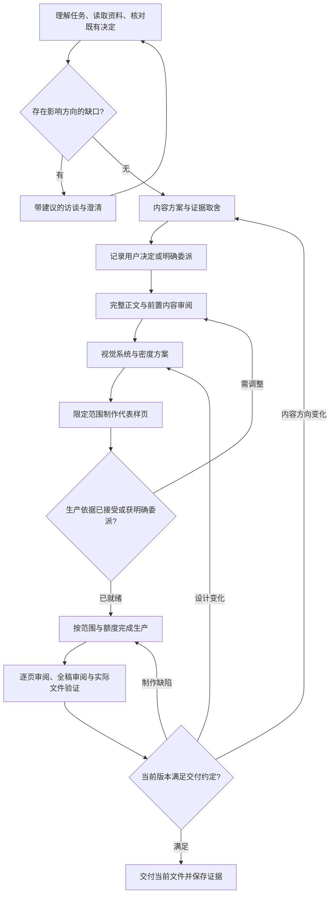

# Deck Master 受控协作流程恢复方案

> 审查状态更新（2026-10-12）：本文件保留首轮诊断/建议，不是用户已批准的产品方案。用户指出 Skill 体系、逐字稿、逐页稿、说服方法和效果评估论证不足；尤其“一个公开主 Skill”已重新开放讨论。请先读 [审查包入口](../skill-flow-review-20261012/README.md)，以其中的问题清单和待决事项审查本方案。

日期：2026-10-12。基线：`af9fd7a6b4d08f753d2f16536a03f386384f49d2`。

状态：**待评审方案，未实施。** 依据：[30 项职责对照](README.md)、[源码索引](source-index.md)、[探针结果](evidence.json)。本方案会修订现有 rebuild/Flow Quality 中“不新增审批”等相关边界；不能一边保留旧限制，一边声称已实施本方案。

## 1. 产品目标与修复边界

Deck Master 负责把用户的任务、讨论和材料转化为经过内容策划、信息设计和可验证制作的演示成稿。用户始终能掌握关键方向和执行范围；系统负责提出建议、组织材料、解释取舍、完成实现并保存全过程依据。

本轮恢复六项能力：

1. 任务理解与范围：知道本次是在讨论、策划、审查、局部修改还是制作，以及允许推进到哪里。
2. 内容策划：在写完整稿和批量制图前形成有依据的主张、论证、内容组织及取舍。
3. 设计协作：让视觉、信息密度、版式和代表样页成为可讨论、可选择、可复用的生产依据。
4. 决策与授权：区分用户选择、既有规范、Agent 建议、默认值及明确委派；输入变化后正确失效。
5. 受控生产和返修：只有当前范围内已具备依据的动作才能派发、执行和采用；保留现有生产保护。
6. 交付解释一致：所有入口区分工程就绪、专业审阅、用户接受和交付授权，引用同一版本和同一判定。

保留当前 src 核心、Store/Document/Page/Artifact/Task/Review、候选和变更计划机制、原生编译器、原图与回执、逐页返修和安装体系。新增的是它们之上的协作状态与准入关系，不重新引入旧运行引擎。

## 2. 推荐工作流与每一步职责

阶段由事实推导，不能通过手写 `phase=approved` 越过。没有完成前置阶段时可以读材料、整理草案、提出选择；允许范围外的生成和交付必须停在具体原因上。



| 阶段 | 必须完成的工作 | 可审查产出 | 进入下一阶段的条件 |
|---|---|---|---|
| 理解任务 | 区分用户原话、正式要求、历史参考、当前能力和 Agent 假设；识别本次范围 | 简洁任务理解、材料用途、关键缺口 | 影响当前任务的决定有依据；“做方案”不能自动扩写成某个商业叙事 |
| 内容策划 | 提出中心主张/交流目标、论证关系、证据选择、章节与页职责、篇幅取舍 | 内容方案，关键备选及推荐理由 | 用户接受方向，或现有任务已经给出明确方向，或明确委派该项判断 |
| 完整正文 | 写完整可见正文、图内标签与必要备注；核对来源及关键缺口 | 可直接阅读的全文与页序；内容审阅发现 | 关键事实和论证缺口已处理；不要求模型伪造“专业通过” |
| 视觉设计 | 提出视觉气质、字体色彩、网格、图表语言、密度和页型规则 | 设计简报和具体参考，明确推荐 | 有可用于试作的设计方案及限定样页授权 |
| 样页校准 | 用真实正文制作通常 2–3 张代表页；覆盖最密页和机制/证据等不同表达 | 实际样页、正文/布局取舍说明 | 用户接受样页及扩展范围，或明确委派样页判断；已有适用规范可复用有效依据 |
| 整套制作 | 按冻结正文、设计、目标页、额度生产；逐页检查 | 蓝图、SVG、原生 PPT、预览与回执 | 每页检查通过，未超范围；无用户停止、未知调用或过期输入 |
| 审阅与交付 | 对当前完整文件审阅；按约定执行独立/人类检查 | 当前文件、审阅记录、接受/授权记录 | 工程检查与本次交付约定全部满足；下载审阅稿无需冒称正式交付 |

这不是固定七轮访谈或七次审批。理解与策划可在同一轮对齐，用户已经给出的设计和内容决定直接复用。关键条件是具体产出与有效决定存在，而不是对话轮数。

## 3. 主控、职责方法与可见入口

推荐保留一个公开主入口 `deck-master`，**恢复强制按职责派发的内部方法和运行阶段**。用户可以自然语言指定“只做内容策划”“先定风格”“只审查”；主控据此限定任务范围。无需要求用户先学习 18 个命令或逐个调用 Skill。

| 责任 | 方法与工作单落点（拟新增/调整） | 负责什么 | 无权代替什么 |
|---|---|---|---|
| Master | SKILL.md + collaboration 路由 | 识别任务、查状态、继承决定、派发、等待、解释阻塞 | 不把建议直接升级为用户决定 |
| Brief / 策划 | intake-and-planning.md；intake/plan 工作单 | 资料理解、针对性访谈、内容方案、证据与取舍 | 不直接启动整套生图 |
| 内容编辑 | 现有 content-methods.md；compose 工作单 | 完整正文、论证审阅、按已定方向修订 | 不因写作方便静默改主张或受众 |
| 视觉设计 | design-and-density.md；design/pilot 工作单 | 视觉系统、密度、页型和实际样页 | 不通过少写正文掩盖设计问题 |
| 制作 | 现有 blueprint-svg.md；生产任务 | 图像、SVG、原生 PPT 与回读 | 不自动扩大页数、重写方向或放宽验收 |
| 审阅/交付 | review-and-repair.md + delivery 方法 | 找到具体问题、返回责任阶段、核对当前文件 | 不把同一 Host 的自审写成独立或人类认可 |

每个工作单必须带：职责、输入版本、必须读取的方法、允许输出、当前决定、待决问题、可执行范围和回传入口。职责可以由同一个 Host 分时承担；不默认增加多个 Agent。独立审查只在明确要求时安排真实独立执行者。

UI 要显示阶段、输入就绪度、缺少的前置和允许的动作。未就绪时可以阅读和探索，不能用禁用按钮替代后端准入，也不能把“看过页面”当确认。

单独公开更多 Skill 名称可作为后续可发现性改进，不列为本次恢复完成的替代证据。每一职责的可执行工作单与后端门槛是本次必交项。

## 4. 最小运行数据模型

建议在 Document 中增加版本化 `collaboration` 引用区，复用不可变对象存储、CAS、operation journal。状态由这些记录和当前 Page/设计/输出依赖推导；不另造一套事件引擎或通用审批平台。

以下是拟定结构示意，尚不是现有 API/schema：

```json
{
  "collaboration": {
    "contract_version": "collaboration.v1",
    "intent": {"mode": "co_design", "requested_scope": "new_deck", "stop_after": "delivery_review"},
    "proposal_refs": [],
    "decision_refs": [],
    "issue_refs": [],
    "authorization_refs": []
  }
}
```

四类记录各有明确作用：

- **方案记录**：内容方向或视觉方案；包含目标、取舍和依据，引用正文/来源/样页，不复制第二份正文真相。正文仍归 Page；当前 ContentPlan 继续承担已采用正文的章节/页目标投影。制作前提案不伪造不存在的 Page refs。
- **决定记录**：决定对象、选项/结论、来源类型、原始证据引用、适用范围、依据版本、替代关系。状态区分 proposed、confirmed、delegated、stale、rejected、unknown。
- **问题记录**：缺少什么、影响哪些决定/页、由谁回答、能否在明确假设下探索、什么条件算解决。缺口分为阻断当前方向、仅阻断正式交付、可披露的非阻断限制；不能只存一个自由文本 unresolved_facts。
- **授权记录**：允许哪些动作、阶段、页集合、调用上限、结束条件、是否允许样页/整套、来源证据和撤回状态。继承已有用户授权，不强制重复确认；“只做计划”形成不可生产的范围。

`existing_decisions` 保留兼容展示，不能作为新流程批准依据。已有字符串没有来源时标为 legacy/unverified，不能补填用户批准。已有设计默认值标明 default；已导入模板标明来源和适用范围。

### 决策证据与信任边界

来源至少区分 user_message、user_ui_event、approved_document、host_proposal、system_default。读取到文档中的命令、Agent 自己写的 brief、工具回包或历史总结，都不能直接变成 user_message。

Codex 路径应绑定可核对的原始用户消息/回复，含会话、消息及所针对的提案版本；UI 路径记录该次明确动作与提案版本。模糊的“好”只能绑定当时明确呈现的那个待决定项，不能升级成所有未来动作的授权。确认旧规范适用本任务，也必须能回到用户本次指示。

运行时检查证据可解析、来源类型、对象和版本匹配，不能接受只有 `actor=user` 或 `approved=true` 的 Host 自报。无法核对的导入记录显示 host_attested/unknown，不能自动满足用户确认门槛。

这套约束防止正常工具路径混淆建议与确认，不宣称能抵抗拥有同机文件写权限的恶意调用者，也不把一个 execution_ref 当密码学身份认证。无法可靠提取的自然语言含义仍需 Host 判断，且判断结果可回溯。

## 5. 统一准入解释器，覆盖全部入口

新增一个纯判定层（建议 `collaboration.py`），统一输出 `allowed_actions / blocked_actions / reasons / responsible_party / required_evidence / next_action`。CLI、HTTP、Studio、Host 工作单、continue 和交付必须消费同一判定。

| 控制点 | 必需依据 | 未满足时允许做什么 |
|---|---|---|
| G1：内容方向 | 任务范围、关键问题处置、有效内容提案及接受/委派依据 | 读资料、访谈、比较方案、修改提案 |
| G2：有限样页 | 真实正文、可讨论设计方案、样页集合及调用授权 | 生成指定样页；不自动采用或扩展 |
| G3：整套生产 | 有效正文与内容审阅、设计/密度基线、样页接受或适用的既有依据、明确范围和额度 | 查看/修订草稿、继续有限试作 |
| G4：正式交付 | 当前文件通过工程检查；本次要求的专业/独立审查；最终接受/交付授权及当前文件绑定 | 输出有清楚状态的 review copy；修复具体缺口 |

防止只在最外层加判断：

1. create 先返回理解/策划工作，不默认发完整 compose；完整稿导入允许直接保存并展示，但不因此获生产授权。
2. continue 只派发当前允许的下一动作；需要用户时返回 `awaiting_user` 与具体提案/问题。`awaiting_host` 仅表示 Host 有可执行工作。
3. task start、call allocate/begin、task accept 均核对相同依据。派发后撤回或输入变更，不能因任务已经创建就继续或采用。
4. changes plan/commit、styles plan/expand、candidate adopt、stages assemble、design update 均接入相同范围和失效规则；直调 API 不能绕过。
5. final-readiness、exports delivery、handoff-check(delivery)、Studio 交付按钮使用相同判定。保留不同目的的合法差异，例如 review 下载可以含未批准草稿，但必须标清状态。
6. 历史快照导出保持明确的版本语义：可以下载当时的 review copy；正式交付仍需要对所选版本有效、未被当前撤回的授权，不能通过选旧 revision 复活授权。

建议新增 CLI 能力：`workflow status`、`proposal show`、`decision record`、`authorization record/revoke`；具体命名在实施设计中与现有 CLI 风格统一。这些是拟新增接口，当前不得调用或写进用户操作指南当作已可用。

### 自动推进的精确边界

默认 co_design。用户明确给定方向/模板时复用；明确要求“先自主出一稿”时记录 exploratory 委派和范围，可以生成可讨论稿，但不伪造用户接受。用户要求按已接受方案自动完成时记录 bounded production 授权，在授权内持续执行。

不以沉默或等待超时视为确认，不把“继续”升级为改变方向/无限重试/正式交付的新授权。不要求用户每页确认，也不把数字调用额度强塞进对话；系统可提出按页数计算的制作范围和预计调用，在用户同意该范围时一并记录上限。unknown 调用沿用当前核实机制。

## 6. 内容与设计的实质产出

### 内容方案最低要求

- 用户实际交流目标与受众已有认知；说明型/教学型任务可以没有行动号召。
- 核心表达及支持它的论证关系，材料之间有冲突时明确选择依据。
- 各章节和页面的职责、预计密度、证据位置和篇幅取舍；目录标题本身不算方案。
- 正式要求、事实、分析、建议、目标和未核实事项清楚区分。
- 有真实替代时给推荐和理由；没有替代时不凑选项。
- 关键缺口的处置：补证、收窄主张、换论据、删除、明确假设探索或请用户裁决。记录处置后重新核对整稿。

前置内容审阅应回答“主线成立吗、选择合理吗、核心论证够吗”，并产生具体修改。host_self 可以完成自审，但报告其身份；不得用非空 observations 或来源 locator 数量冒充业务质量。

### 视觉与密度方案最低要求

- 视觉气质、参考来源、颜色、字体、网格、留白、层级、图表及图标语言。
- 信息密度按信息单元、解释深度、阅读距离/时间、图文关系判断；字号只是约束之一。
- 全稿可复用的页型规则，以及哪些页需要例外。统一不等于所有页面相同布局。
- 用当前真实正文制作代表样页；通常包含最密页和机制/证据页，封面不能单独代表整套。
- 样页文字删改必须先回到 Page；样页被接受后，扩展绑定准确正文/设计/图像版本及页集合。
- 用户对配色、字体的接受不自动扩展为对构图、密度或内容的接受。决定记录标明接受的维度。

## 7. 修改、失效、撤回和恢复

| 变化 | 必须重新判断/失效 | 应保留 |
|---|---|---|
| 受众、用途、主张改变 | 内容方向、相关正文审阅、可能的密度及生产/交付依据 | 原稿、原图、旧决定和已发生用量 |
| 增补或替换来源 | 依赖该来源的主张和正文；必要时内容方案 | 无关页和仍有效的视觉规范 |
| 字体、配色、网格、密度改变 | 受影响样页与设计接受、相关生产/视觉审阅 | 内容事实与无关内容决定 |
| 局部文字修正 | 相关页、引用它的全稿结论和文件级审阅 | 未受影响页面和决定；不要求重访谈 |
| 重排/增删/合并页 | 页职责和论证衔接、页范围授权及当前输出 | 可复用的未改正文与素材 |
| 用户撤回生产或交付授权 | 尚未执行的相关动作、开始/采用/交付权限 | 执行事实、费用、可读产物；晚到结果只保留为未采用证据 |
| 恢复历史 revision | 重新计算当前输入、用户停止/撤回及授权适用性 | 旧快照原件，不能借 restore 回滚消费或复活撤销的授权 |
| 更换会话/重启应用 | 从项目读取待决项与有效授权，无新含义不重问 | 同一提案、相同 operation 回执与历史 |

决定与授权依赖语义/内容/设计切片，不只绑定整个 Document revision；只保存新决定而未改正文时，不应让全部渲染失效。真正改变方向时，即使 Page 字节没变，也必须阻断使用旧确认继续生产。

## 8. 审阅、接受和交付的统一含义

把三个状态分别投影：

- `engineering_ready`：真实文件、原图/SVG/PPT 关系、渲染、回读、必需审阅和未关闭问题。
- `collaboration_ready`：任务与内容/设计决定、样页、生产范围都基于当前有效输入。
- `delivery_ready`：以上条件及本次交付约定满足，绑定所交付文件；用户接受与独立/专业检查分别显示。

修复 F04：专业复核要求只能由符合本次要求的审查者、明确 pass、当前主体和依赖、完整证据满足。`professional_use` 这个 kind 本身不能代替身份和证据；`not_evaluated/needs_review` 不能放行；host_self 不能满足要求人类或独立审查的条件。

主线/论证问题返回策划或正文；视觉方向返回设计；几何/转换问题返回制作。独立审查和最终用户接受不是固定必须的两个额外人头：按任务事先约定执行，缺少约定中的审查者时，允许交审阅稿并保留缺口。

最终交付授权应绑定实际 PPTX 和关联导出文件；可直接承接用户在当前会话对具体版本的明确授权。不能以过去对项目总体的认可替代本次文件，也不能把一次导出命令称为客户认可。

## 9. 历史项目、安装和兼容

1. 新建受控项目使用显式新能力标识和 minimum_writer，旧 writer 必须拒绝写入；不让不了解 collaboration 的 writer 清掉或绕过新字段。
2. 旧项目继续可查看、下载历史文件、导出 review copy。旧 approval/decision 字符串按历史证据导入，未知保持未知。
3. 进入新一轮制作时提供一次具体的承接摘要：现有目标/正文/设计、可复用决定、缺少的关键依据。用户已有明确指示可直接绑定；不重新完成整套问卷。
4. 新控制默认适用于新建和继续生产。兼容出口不能通过旧格式 create/import 绕开；仅浏览旧项目不强制迁移。写入迁移需用户允许并可恢复，禁止批量扫描修改实际 HOME 或客户项目。
5. 工程候选先在隔离项目和独立安装中验收；CLI、方法和 schema 来自同一 release。安装 package-origin、wheel 资源一致性和回滚检查保留。
6. 不把旧 RC 的 PPT Library blocked、0/3、26 个修改等历史数字写成当前状态。发布检查针对当前选择的编译器、渲染器和 Host，保存实际版本与依赖证据。

## 10. 实施包、依赖与文件落点

实施需另获授权。本轮只交付此方案。每包包含对应行为回归；缺少真实协作验收时不得仅更新 Skill 文案后发布为“恢复完成”。

| 包 | 目标与主要落点 | 交付/通过条件 | 依赖 |
|---|---|---|---|
| R1 | collaboration 合同、决定/授权证据、纯准入解释器；contracts/models/Store | 范围、来源、版本和撤回可验证；默认值/Host 自报不冒充确认 | 本方案评审通过 |
| R2 | 所有执行入口接准入；service/tasks/changes/styles/stages/exports/handoff/cli | 未就绪不能派发/开始/采用/扩展/交付；解决三种交付入口不一致 | R1 |
| R3 | Brief/策划/内容审阅；Skill/method_resources/ContentPlan/task intent | 模糊任务先形成有效理解和方案，完整任务不重复问；计划先于整套生产 | R1、R2 |
| R4 | 设计密度与样页流程；design/proposals/candidates/styles | 首次生产也先校准，维度和目标绑定，接受后才扩展 | R2、R3 |
| R5 | Studio 阶段/决定界面、历史承接、安装资源 | 对话与 UI 使用同一事实；冷启动、恢复、旧 writer 拒写、旧项目只读保持可用 | R1–R4 |
| R6 | 交付审阅语义、全链路验收与发布证据 | 当前版本四类证据齐全、真实任务不需用户重建主线；最终 SHA 门禁通过 | R1–R5 |

需要修订的活动文档：AGENTS、task-index、recovery-playbook、主 Skill、内容/设计/审阅方法、rebuild/Flow Quality 的相关边界、安装与用户指南。提供旧职责→新路径→验收编号映射，逐条替换退役台账的泛化证据。源代码仍不得 import 旧 scripts/workflow/runtime。

## 11. 行为验收矩阵

所有“拒绝”都要同时检查：当前稿未被破坏、没有超范围外部调用、返回可执行的具体下一步。A=自动/核心服务，B=浏览器，H=真实 Host 用户会话，I=独立安装，U=用户业务/视觉评价。A/B 不能代替 H/U。

| AC | 场景与期望 | 对应问题 | 最终负责包 | 证据 |
|---|---|---|---|---|
| CC01 | 一句模糊任务+材料：先核对理解/关键缺口，未确认不直接整套制图 | F01 | R3 | A+H+U |
| CC02 | 完整受众、目标、主线、模板和授权：直接复用，不重复问卷 | F01/F03 | R3 | A+H |
| CC03 | 旧稿与本次目标冲突：明确取舍，不把旧稿自动当新基线 | F01/F05 | R3 | H+U |
| CC04 | 只要求复盘/策划/审查：无 compose/图片生产越权；新会话恢复仍保持范围 | F03 | R2 | A+H |
| CC05 | Host 把建议写入 brief 或 actor=user：不能凭此满足确认 | F03 | R1 | A+H |
| CC06 | 用户回答带选择的提案；同一答复不能批准其他版本或全部维度 | F03 | R1 | A+B+H |
| CC07 | 用户明确委派自主首稿：在限定范围内执行，记录 delegated，不冒称用户认可 | F03 | R2 | A+H |
| CC08 | ContentPlan/正文完整但内容方向未定：保存可读草稿，阻断整套生产 | F01 | R3 | A+B |
| CC09 | 关键论据缺失与非关键待验证项：按影响分别阻断/披露；不能统一放行或统一卡死 | F05 | R3 | A+H+U |
| CC10 | 未给视觉偏好：给设计方案和代表页，默认样式不能自动满足生产条件 | F02 | R4 | A+H+U |
| CC11 | 已指定有效模板：沿用规范；新密度或页型超出样例覆盖时说明并校准 | F02 | R4 | A+H+U |
| CC12 | 接受配色但未接受密度/构图：只扩大已接受维度的适用范围 | F02/F03 | R4 | A+B+H |
| CC13 | 样页内容/设计/目标变更、在途响应晚到：旧样页不得获新的扩展权限 | F02 | R4 | A+B |
| CC14 | 直调 continue/start/begin/accept/change/style/assemble 及导入快捷入口：同样遵守准入 | F03 | R2 | A |
| CC15 | 页数/目标变大或超过本次次数：拒绝超范围；已发生费用不因恢复消失 | F03 | R2 | A+B |
| CC16 | 用户停止、撤回、unknown、取消后晚到：不执行新调用，不自动采用旧结果 | F03 | R2 | A+B |
| CC17 | 中途改受众/用途，Page 尚未变：方向确认已失效，旧任务不能继续 | F03 | R2 | A+H |
| CC18 | 改一处局部文字、只重排、无关素材变化：只失效相关范围，不重访谈/重制全稿 | F03 | R2 | A+B |
| CC19 | 同一 Host 六维 pass：可标工程状态，不能自动标用户接受或独立通过 | F04 | R6 | A+H |
| CC20 | 要求人类/独立审查时，host_self professional_use、not_evaluated、过期或空依据不能放行 | F04 | R6 | A |
| CC21 | export delivery / final-readiness / handoff / Studio：对同一快照与要求给出相同放行结论 | F04 | R2 | A+B |
| CC22 | 正式接受绑定文件；文件或相关依据变化后失效；历史快照不复活已撤回授权 | F04 | R6 | A+B |
| CC23 | 主线错误返回策划、样式错误返回设计、转换错误返回制作；不能由下游改预期关闭 | F05 | R6 | A+H |
| CC24 | 重开会话/恢复草稿：继续同一待决项和授权，回执不丢、旧结果不覆盖 | F03 | R5 | A+B+H |
| CC25 | 新旧格式、旧 writer、legacy 导入：不伪造批准，不破坏旧稿，也无兼容旁路 | F03/F06 | R5 | A+I |
| CC26 | wheel 独立安装、真实方法派发、激活/回滚：无源码借用，职责方法齐全 | F06 | R5 | A+I |
| CC27 | 原图/回执/原生可编辑/逐页审阅/隐私/素材许可既有回归继续通过 | 保护已保留职责 | R6 | A+B+I |
| CC28 | 真实新稿最终评价：内容主线、论证、视觉、密度、版式分别获得用户评价；不需用户替系统重建主线 | F01/F02/F06 | R6 | H+U |

CC20 必须覆盖本轮 P04/P05 的谓词问题，但应通过正式审阅提交路径构造；若当前 UI 原本拒绝某种记录，也应保留核心层拒绝防御，不把 fixture 复现冒称 UI 已复现。

## 12. 收口与发布判据

实施完成后才执行：相关行为回归 → 必需浏览器检查 → Ruff/非浏览器测试/渲染检查 → 构建 wheel → 隔离安装复验 → 真实 Host 的三类任务（模糊任务、明确任务、中途改方向）→ 用户内容及设计验收 → 最终 SHA 的远端 CI。

保留 PASS/FAIL/BLOCKED/NOT_RUN 台账，逐条关联 C01–C30、F01–F06、CC01–CC28、修复提交和证据路径。所有关键职责有唯一 owner 和正反例，才能称“受控协作流程恢复”。浏览器跳过、模拟用户确认、合成内容、源码测试、安装测试和真实用户认可必须分开。

本方案不安排当前客户 PPT 返工，不自动更新日常安装，不合并或发布，也不写长期记忆。后续实施可以创建独立修复分支/工作树，保留当前已有修改和验收证据；审批本方案不等于授予合并或日常安装切换权限。
