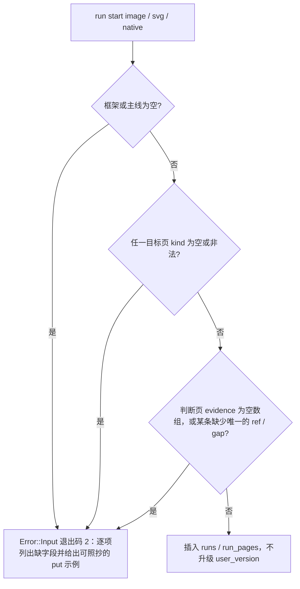
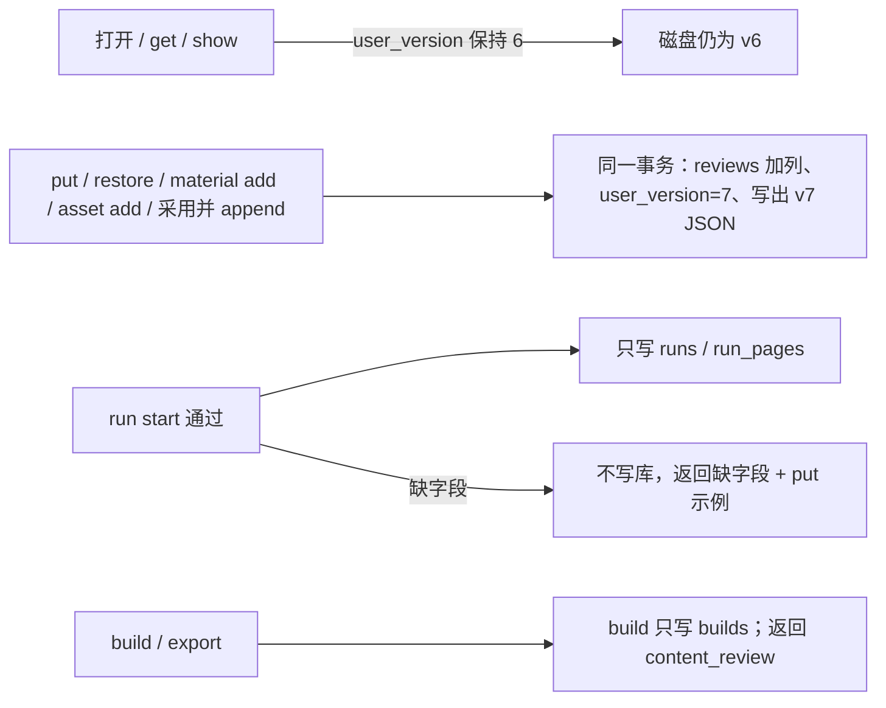

> 历史背景副本，已移除私有来源信息。本文中的待批准、额度、运行顺序和旧状态规则均不作为当前执行指令；当前范围、行为与验收统一见[现行开发稿](../rust-rebuild/README.md#当前内容质量增量2026-11-23)。原 SHA 仅为历史引用，不是净化副本的内容校验值。

# Deck Master · 内容质量轮 v7 字段与门设计（2026-11-21）

**结论：** `page.preview` 字节无法确认为可复现，出稿审稿的主绑定用 `version_id` + 每页 `page.revision`，预览标识只作附带记录、不参与 stale 判定。`page.kind` 为空时 `run start` 拒绝，不把空页型当作判断页；判断页 `evidence` 为空数组同样拒绝；v6 页没有页型时按同一规则处理，并给出可照抄的 `deck put` 示例。`FORMAT_VERSION` 6→7 的整套迁移（含 `reviews` 表加列与快照字段）由 PR-B 一次落地，PR-E 只使用这些列，不再升版本。新程序打开 v6 库默认只读、不写回、不改 `user_version`；只有显式会 `append` `versions.deck_json` 或写入出稿审稿记录的命令才把该库升级为 v7。`deck put` 放行补字段，不拦生成门；`run start` 在拒绝时不写运行记录，通过后只写 `runs` / `run_pages`，不升级格式。

本文只覆盖已批准的偏离 D1–D5，不新增需求。推断处标【假设】。Q1 已选 A（“待补”直接标在页面上），其上屏改动属 PR-D，本文只固定缺口清单仍由 `todo` + `evidence.gap` 计算。

## 0. 文件身份、依据与批准口径

- **本文件**是 r2 第 6 节所说的带日期设计附件，供 SWE 开工 PR-B / PR-C / PR-E。不改 r2 与补充原文。
- **依据（已用 `sha256sum` 实算）：**
  - `deck-master-prd-cut-20261120-content-quality-r2.md`
    SHA-256 `9e2de74c27611c48c37b157bb2deabc2c154bea95af063c6f0efd149e1b033fa`
  - `deck-master-prd-cut-20261120-content-quality-r2-supplement.md`
    SHA-256 `da847b091ff784a218276dc11c270ba44c2e7c17efad45da3e89a5b0b81c7f3b`
- **仓库基线：** `MainQuestAI/Deck-Master` @ `865092226246aa57820aa4cdec291648aa3ddee0`。以下对现行实现的陈述均来自该 SHA 的单文件阅读（`rust/src/{model,store,ops,cli,server,error}.rs`，以及 `deck-skill/deck-review/SKILL.md`），没有 clone，也没有改产品代码。
- **批准口径：** 产品经理于 2026-11-21 08:47（北京时间）向 CodeManger 转述：Los 在该对话卡片中批准 D1–D5，Q1 选 A，PR-A 可先开工。Host 实跑额度 21 次尚未答复，与本设计无关。
- **必含项对照（补充 §4 第 2 条 + §2.11 第 4 条）：** §1.2 可复现性结论见第 2 节；§2.1 kind / evidence 空值及 v6 无页型见第 4 节；§2.2 完整迁移见第 6 节；§2.3 写回与命令对照见第 5、8 节；§2.4 错误样例见第 5.3 节；字段名、JSON 形状与 `X-Deck-Status` 的 `content_review` 键见第 3、7 节。

## 1. 现行结构（设计起点，不改的部分）

来自基线源码，供对照，不是新需求：

- 权威作品文档是 `versions.deck_json`；当前版本是 `ORDER BY id DESC LIMIT 1`。`FORMAT_VERSION` 为 6；库的 `user_version` 高于程序常量时，报「项目格式为 {version}，当前程序只支持 {FORMAT_VERSION}；请升级 deck」（`store.rs`）。
- `Brief` / `Framing` / `Page` / `Deck` 均 `deny_unknown_fields`，多数带 `serde(default)`。因此 v7 程序可以用默认值读 v6 的 JSON；旧程序读带新字段的 JSON 会被 serde 拒绝。所以**必须在第一次写出 v7 JSON 的同一事务里把 `user_version` 升为 7**，让旧程序走「请升级 deck」，而不是落到难以处理的 serde 错误。
- 现行 `configure()` 在打开低于当前格式的库时会自动 `PRAGMA user_version` 升级（v5→v6 即是只改版本号）。v7 **不得**再对 v6 库做这种打开即写回。
- `page.preview` 为 `Option<String>`，存的是 `add_file` 返回的 `{sha256(字节)}.{ext}`。`add_file` 按内容寻址；同一字节再次写入是空操作。SVG 自动采用时把预览写入 `page.preview`；未采用的候选预览只在 `run_pages.preview_file`。native 的预览在 pack 内，自动采用不把 native 标为已采用。`check-page` 在 `preview=True` 时不走 `sanitize.pptx`。
- 页模型里**没有**修订号字段。`reviews` 表现行列为：`id, version_id, page_id, reviewer, method CHECK (self_check|other_model|human), text, status CHECK (open|resolved), created_at, resolved_at`。`review add` 只 `INSERT reviews`，不改 `deck_json`。
- `X-Deck-Status` 已存在（`server.rs` 的 `status_header`）：HTTP 导出时把返回 JSON（含 `missing_pages` / `stale_pages` / `stale_images` / `warnings` 等）整段写入该头。本轮只在同一 JSON 里**新增** `content_review` 键，不改现有键的含义，并与 `warnings` 分开。
- 会 `store::append` 从而改 `deck_json` 的命令：`put`、`restore`、`material add`、`asset add`、`run result`（符合自动采用条件时）、`run adopt`。`run start` 只插入 `runs` / `run_pages`；`build` 只插入 `builds`。`get` / `show` / `workspace` 只读。

## 2. §1.2 `page.preview` 可复现性结论

**结论：不可确认可复现。主绑定采用 `version_id` + 每页 `page.revision`；预览标识只作附带记录，不参与 `unreviewed_pages` / `stale` 判定。**

依据：

1. 标识本身是预览文件字节的 SHA256。若**不重新生成**、只沿用已存的 `page.preview`，标识不会自己变。
2. 但「同一页内容未改动时，重新生成的预览字节是否不变」在基线中没有测试或保证。预览经过 `rsvg-convert` / `soffice` / `pdftoppm` 等路径；`preview=True` 与正式编译是否走 `sanitize.pptx` 并不相同；补充 §1.2 第 6 条已写明本轮不保证单页 `page.preview` 与整稿 PPTX 渲染一致，`build` 也不产出逐页预览。
3. 因此不能把预览标识用作 stale 的判定条件，否则可能把没改过的页误报为 stale（补充 §1.2 明确禁止这种情况）。

落地规则：

- 出稿审稿写入时，程序自动快照：当前 `version_id`、每页 `page.revision`、以及当时的 `page.preview`（文件名，其中已含内容 SHA；缺预览则记 `null`）。Host 不手填 SHA 或修订号。
- `unreviewed_pages`：当前 `page.revision` 与快照不一致的页。预览变化单独出现、修订号未变时，**不**进入该列表。
- 审稿后改一页再导出：该页进入 `unreviewed_pages`，且 `content_review.status=stale`（补充负例二）。
- 快照中的预览标识是新鲜度附带证据，**不证明有人阅图**。阅图仍按 r2 由核验从 jsonl 观察，找不到只记「Host 未阅图」。

`page.revision` 虽未出现在 D1 的字段名单里，但是补充 §1.2 主绑定在「不可复现」分支上的必要字段，纳入同一套 v7 迁移，由程序维护，不对手填开放。不另立偏离编号。

## 3. 持久字段与只读派生输出

字段名称沿用 D1 已列的名字，仅补上 `page.revision`。新字段在结构体上必须 `#[serde(default)]`，以便 v7 程序读 v6 JSON。第一次写出 v7 时，新字段一律写入（空值也写），不再省略。

### 3.1 `brief`（D1，PR-B 落库）

在现有 `title` / `audience` / `task_type` / `goal` / `constraints` / `page_limit` 之外增加：

```json
{
  "decision": "请管理层拍板的待决事项",
  "concerns": ["关注点一", "关注点二"],
  "narrator": { "role": "资深顾问", "tone": "结论先行，语气肯定" }
}
```

- `decision`：字符串，默认 `""`。
- `concerns`：字符串数组，默认 `[]`。AC-01「1–3 个」是核验口径，代码只检查是否非空，不做数量配额。
- `narrator.role` / `narrator.tone`：字符串，默认 `""`。`narrator` 缺省为 `{ "role": "", "tone": "" }`。
- 现有 `brief.audience` 继续表示读者，不改名。

### 3.2 `framing`（D1，PR-B 落库）

在现有 `thesis` / `pillars` / `facts` / `assumptions` / `questions` 之外增加：

```json
{
  "storyline": ["第一句", "第二句"]
}
```

- 默认 `[]`。AC-02「5–8 句」和「早于第一页正文」是核验口径（后者用现有版本历史证明），代码只检查非空。

### 3.3 `page`（D1 的 kind / argument 由 PR-B 落库，门在 PR-C；revision 由 PR-B 落库）

```json
{
  "id": "p1",
  "kind": "judgment",
  "revision": 1,
  "argument": {
    "reasons": ["理由一", "理由二"],
    "evidence": [
      { "text": "材料中的数据或原话", "ref": "m1" },
      { "text": "材料未给出的对比基数", "gap": "待补：需披露口径与年份" }
    ],
    "reasoning": "这些依据如何推出标题中的主张",
    "rebuttal": "可预见的质疑与边界"
  }
}
```

- `kind` 只允许：`judgment`（判断页）、`explanation`（说明页）、`reference`（查阅页）、`teaching`（教学页）。来源是 r1 范围内条目与工程评审已用的英文取值；中文名仅作说明。默认 `""`（表示未标）。不做页型自动分类。非法取值在 `deck put` 与 `run start` 均以 `Error::Input` 拒绝。
- 主张直接取 `content.title`，不在 `argument` 里重复存放。
- `argument` 默认 `null`（JSON `null` 或省略读入后为 `null`）。判断页在生成前应写成对象；说明 / 查阅 / 教学页允许为 `null`。
- `evidence[]` 每一项必须**恰好一个** `ref` 或 `gap`（互斥、非空字符串）。两者都缺：即 AC-03 负例一，`run start` 拒绝并指出页和证据项。两者都有：视为输入不合法，同样拒绝（【假设】：互斥比「以 gap 为准」更不易误标已有出处）。
- `reasons` / `reasoning` / `rebuttal` 缺失或为空时，**不**拒绝生成（r2 AC-03）；这类问题只进入出稿审稿记录或核验发现。`reasons`「2–3 条」是核验口径，不做代码配额。
- `page.revision`：无符号整数，程序维护。读 v6 或值为 0 时，**逻辑初值视为 1**；第一次写出 v7 JSON 时把 0 写成 1，这不算一次内容变更。之后仅在下列**作者字段**相对上一版发生变化时加 1：`purpose`、`layout`、`content`、`notes`、`todo`、`refs`、`kind`、`argument`。只改 `image` / `svg` / `native` / `preview` 不加修订号。`PagePatch` 不接受 `revision`；若提交该字段，因 `deny_unknown_fields` 按输入错误拒绝。
- `Page::author`、`PagePatch` 与 `apply` 须同步 `kind`、`argument`；`preview` / 产物字段仍不可经 patch 写入。

### 3.4 只读派生输出（D5；`writing_brief` / `outline` 随 PR-B，`gap_list` 随 PR-C）

`deck get` 与 `deck show`（以及同一套 JSON 的 HTTP 读取）增加三个**计算字段**，不写入 `deck_json`，也不允许 `put` 回写。

`writing_brief` 由已填写的 narrator、decision、concerns 按固定模板拼出（缺项跳过该行，避免手写发挥）：

```
讲述人：{role}。语气：{tone}。
待决事项：{decision}。
读者关注点：
- {concerns[0]}
- {concerns[1]}
```

`outline` 按当前页序：

```json
[
  { "page_id": "p1", "kind": "judgment", "title": "判断句标题" }
]
```

`kind` 未标时写 `""`。核验人只读 `outline` 复述主线，是人判，不是产品配额。

`gap_list` 由各页 `todo` 与该页 `argument.evidence` 中带 `gap` 的项计算，不新增手填字段：

```json
[
  { "page_id": "p1", "source": "evidence", "text": "材料未给出的对比基数", "gap": "待补：需披露口径与年份" },
  { "page_id": "p2", "source": "todo", "text": "页面待办原文" }
]
```

同一证据缺口只在承载它的主页出现一次（由 Host 按页标注；程序按页汇总，不去重改写原文）。Q1-A 的「待补：…」上屏由 PR-D 改提示词与开发稿，不在本文件展开。

## 4. 生成门（D3 / 补充 §2.1 / v6 无页型）

只作用于 `run start image|svg|native`。`deck put` 与 `build` / `export` 不拦。拒绝时使用 `Error::Input`，退出码 2，在插入 `runs` **之前**返回，避免留下半截运行记录。

### 4.1 检查顺序



「框架」指生成前锁定的：`brief.audience`、`brief.decision`、`brief.concerns`（非空数组）、`brief.narrator.role`、`brief.narrator.tone`，以及 `framing.storyline`（非空数组）。仅空白字符视为空。

### 4.2 `kind` 为空：选择拒绝，不按判断页处理

补充 §2.1 允许「为空则拒绝」或「为空按判断页处理」，二者择一。本设计选前者。

理由（不新增需求，只是在已给选项中取值）：空页型若默认为判断页，会把未标页型的说明 / 查阅 / 教学页（以及全部 v6 旧页）一并套上证据门，既容易误伤，也和「不做页型自动分类」相冲突。显式拒绝并列出 `pages[<id>].kind` 与示例 `put`，才能满足 §2.4「可处理的提示」。

### 4.3 判断页 `evidence` 为空数组

`kind=judgment` 且（`argument` 为 `null`，或 `evidence` 缺省 / 为 `[]`）时拒绝。这是 D3 同一道门的措辞补全，对应 AC-03 新增负例四。标了 `gap` 的条目可以放行，并进入 `gap_list`（负例二）。

### 4.4 v6 页没有页型时，§2.1 的门怎么处理

v6 JSON 没有 `kind` 字段，v7 程序读入后为 `""`。对目标页按 4.2 处理：**拒绝，不默认为判断页**，也不在只读打开时改写磁盘。错误信息把这些页的 `pages[<id>].kind` 与空的框架 / 主线字段一并列出，并给出 `deck put` 示例。补填且 `put` 成功后，库已是 v7，再 `run start` 才可能放行。

## 5. v6 的打开、写回与被拒样例（§2.3 / §2.4）

### 5.1 默认只读、不写回

打开、`get`、`show`、`workspace`、`doctor`、`review list` 不得修改 `user_version`，不得 `ALTER`，不得 `append` `deck_json`。这样用户仍可用旧程序打开该库。

不采用打开即自动升级。现行 v5→v6 那种「一打开就改 `user_version`」若用在 v6→v7，会在用户尚未保存新字段时就让旧程序无法打开，和补充 §2.3 默认口径冲突。

### 5.2 哪些命令会把 v6 写回为 v7

凡是会把当前作品模型写入 `versions.deck_json` 的命令，在同一事务中：若 `user_version < 7`，先按第 6 节做 reviews 表迁移并 `PRAGMA user_version=7`，把各页逻辑修订号 0 写成 1，再 `append`。写回后旧程序打开即提示升级。

| 命令 | 是否写回 v7 | 与门、运行状态的对齐 |
|---|---|---|
| `deck get` / `show` / `workspace` / `doctor` / `review list` | 否 | 只读 |
| `deck review add`（默认意见，不含出稿审稿） / `review resolve` | 否 | 只写现行 `reviews` 列，不改格式 |
| `deck run start` | 否 | 先做生成门；拒绝则不写库。通过后只插入 `runs` / `run_pages` 及工作目录，**不**升 `user_version`、不 `append` |
| `deck run call` / `cancel` / `show` | 否 | 只改运行状态 |
| `deck build` / `export pptx` / `export md` | 否 | `build` 只插入 `builds`；导出只读已有成品。二者都返回 `content_review`，都不拦、都不升级格式 |
| `deck put` | **是** | 保存草稿，不跑生成门，是补字段并放行后续 `run start` 的主路径 |
| `deck restore` | **是** | 把历史版本追加为新版本；经 v7 序列化写出 |
| `deck material add` / `deck asset add` | **是** | 现行实现会 `append`，因此也升级格式 |
| `deck run result`（自动采用并 `append` 时） / `deck run adopt` | **是** | 只改产物或 `page.preview` 时不加 `page.revision`。未采用、只更新 `run_pages` 时不升级格式 |
| `deck review add --record content_review` | **是**（先要求或完成格式升级，再插入审稿行） | 若库仍为 v6：先拒绝，并提示用 `deck put` 补字段升级（与 §2.4 同一条路），不在审稿命令里悄悄升格式。【假设】：避免一次审稿把未补框架的旧库写成 v7 |
| `deck new` / `deck import`（新目录） | 新建即为 v7 | 不改源目录里的 v6 库 |

不另增「专门的 migrate 命令」。补字段与升级都走已有的 `deck put`。

### 5.3 v6 被拒时的错误信息样例（AC-01 负例）

前缀沿用现行 `Error::Input` 的「输入有误：」。必须逐项列出缺少的字段，并给出可直接照抄的示例命令与最小 JSON。

```
输入有误：无法开始生成。当前作品缺少以下字段：
- brief.audience
- brief.decision
- brief.concerns
- brief.narrator.role
- brief.narrator.tone
- framing.storyline
- pages[p1].kind
- pages[p2].kind
请先用 deck put 补全后再执行 run start。示例（--base 换成 deck show 中的当前版本号）：

  deck put --base 3 payload.json

payload.json 最小片段：
{
  "brief": {
    "audience": "管理层",
    "decision": "本周需拍板的事项",
    "concerns": ["关注点一", "关注点二"],
    "narrator": { "role": "资深顾问", "tone": "结论先行，语气肯定" }
  },
  "framing": {
    "storyline": ["第一句主线", "第二句主线"]
  },
  "pages": [
    { "id": "p1", "kind": "judgment" },
    { "id": "p2", "kind": "explanation" }
  ]
}
```

判断页证据问题使用另一条，指出页和证据项，例如：

```
输入有误：无法开始生成。判断页证据不完整：
- pages[p1].argument.evidence 为空，请至少提供一条带 ref 或 gap 的证据
- pages[p3].argument.evidence[1] 既没有 ref 也没有 gap
请用 deck put 补全，例如：

  deck put --base 4 payload.json

{
  "pages": [
    {
      "id": "p1",
      "kind": "judgment",
      "argument": {
        "reasons": ["理由一", "理由二"],
        "evidence": [
          { "text": "出处或待补说明", "gap": "待补：需补充口径" }
        ],
        "reasoning": "",
        "rebuttal": ""
      }
    }
  ]
}
```

`put` 只需提交有改动的单元；上例中的 `brief` / `framing` 若已存在于当前作品，补证据时不必重交。示例里的空 `reasoning` / `rebuttal` 可写、不作为生成门。照此补填后，`run start` 应当能够放行（AC-01 / AC-03 负例所要求的「可处理」）。

## 6. 完整 v7 迁移（§2.2，PR-B 一次落地）

`FORMAT_VERSION` 改为 7。

**打开时（只读）：**

- `user_version == 7`：直接用。
- `user_version > 7`：仍报「请升级 deck」。
- `user_version == 6`：不改磁盘，用带默认值的模型读现行 `deck_json`。
- `user_version < 6`：继续沿用基线里 0→6 的表迁移逻辑，但停在 6，**不**在打开时升到 7。

**第一次 v7 写出时（与 `append` 或出稿审稿升级同一事务）：**

1. 若 `user_version < 7`，对 `reviews` 加列（已存在则跳过）：

```sql
ALTER TABLE reviews ADD COLUMN record_kind TEXT NOT NULL DEFAULT 'comment'
  CHECK (record_kind IN ('comment', 'content_review'));
ALTER TABLE reviews ADD COLUMN snapshot_json TEXT;
ALTER TABLE reviews ADD COLUMN checks_json TEXT;
```

2. `PRAGMA user_version = 7`。
3. 将各页 `revision` 的 0 写成 1，按第 3 节序列化全部新字段，再 `INSERT` 新的 `versions` 行（若本次命令本身就要 `append`）。

旧意见行的 `record_kind` 默认为 `comment`，现行 `review add` / `list` / `resolve` 的列集不变，行为不变。PR-E 只使用 `record_kind='content_review'` 以及 `snapshot_json` / `checks_json`，不得再改表或升版本。r2 rL192「在 PR-B 的迁移上追加」已由补充废止。

`deck new` 与 `import` 到新目录时，直接建 v7 表（含上述列）并写入 `user_version=7`。

开发稿 §3.3 / §3.5 / §3.6 在**同一个 PR** 里随代码修改，不另建 spec 目录（r2 偏离清单下的约束）。本轮 UI 不支持编辑新字段，在 PR 描述写明「UI 未覆盖」。

## 7. 出稿审稿、`content_review` 与 `X-Deck-Status`（D4，PR-E 使用 PR-B 的列）

### 7.1 命令

在现有 `deck review add` 上增加可选 `--record`，默认 `comment`（现行意见，不改格式）。出稿审稿：

```
deck review add --record content_review --method self_check|other_model|human --checks checks.json [--reviewer author] [可选说明]
```

- 库若仍为 v6：拒绝，提示先 `deck put`（见 5.2）。
- 程序快照当前 `version_id`、每页 `revision` 与 `preview`，写入 `snapshot_json`；Host 不传这些值。
- `page_id` 为空（整稿一条）。`text` 允许为空或作简短说明（仅此种记录放宽「意见内容不能为空」）。
- `checks.json` 必须具备以下六项（来源：r1 范围内第 7 条，r2 沿用），每项有结论文本和页码列表。代码只检查六项是否到齐，**不**根据结论汇总通过或不通过。

```json
[
  { "id": "storyline_coherence", "title": "主线是否连贯", "conclusion": "……", "pages": ["p1", "p2"] },
  { "id": "evidence_supports_claim", "title": "证据能否推出结论", "conclusion": "……", "pages": ["p3"] },
  { "id": "anticipated_objections", "title": "可预见的质疑是否已回答", "conclusion": "……", "pages": [] },
  { "id": "overdefense", "title": "去防御检查", "conclusion": "……", "pages": [] },
  { "id": "no_internal_notes", "title": "读者可见页面上没有内部备注", "conclusion": "……", "pages": [] },
  { "id": "final_pages_viewed", "title": "最终页确实被看过", "conclusion": "……", "pages": ["p1"] }
]
```

「最终页确实被看过」在记录里只是 Host 写的结论；程序快照不能当作阅图证明。

### 7.2 只读字段 `content_review`

`build`、`export pptx`、`export md` 的返回增加：

```json
{
  "content_review": {
    "status": "unreviewed",
    "methods": [],
    "version_id": null,
    "unreviewed_pages": []
  }
}
```

计算规则（取 `record_kind='content_review'` 中 id 最大的一条为当前绑定）：

| 情形 | status | methods | version_id | unreviewed_pages |
|---|---|---|---|---|
| 没有出稿审稿记录 | `unreviewed` | `[]` | `null` | `[]`（用 status 表达未审，不把全部页列入） |
| 有记录，且所有页的当前 `revision` 与快照一致 | `reviewed` | `[该方法]` | 快照中的 `version_id` | `[]` |
| 有记录，且至少一页 `revision` 与快照不一致 | `stale` | `[该方法]` | 快照中的 `version_id` | 不一致的 `page_id` 列表（稳定排序） |

只改 brief / framing、各页修订号不变时，不把稿标为 stale。【假设】：本轮 stale 按页修订号定义；若后续要把主线或讲述人变更也视为需重审，需另补规则，不在 D1–D5 内私自扩大。

`methods` 用数组，是为了符合 D4 的字段形状；单条记录写入一个 method。代码不读取六项结论来改 status。该字段是提示，不阻断 `build` / `export`。

### 7.3 `X-Deck-Status`

HTTP 的 `/api/build`、`/api/export/pptx`、`/api/export/md` 继续把返回 JSON 写入 `X-Deck-Status`。新增键名为 `content_review`，形状与 7.2 相同，和 `warnings`、`stale_pages` 并列，不合并进 `warnings`。CLI 的 `build` / `export` JSON 使用同一键。

## 8. 命令与格式状态对照（汇总）



## 9. PR 落地划分（不写产品代码）

- **PR-B**（`rust/decision-frame-storyline`）：`FORMAT_VERSION` 7、打开不写回、第 6 节迁移（含 reviews 加列）、第 3.1–3.3 全部持久字段（含 `kind` / `argument` / `revision` 的存取与 `PagePatch` 同步）、框架与主线门、`writing_brief`、`outline`、开发稿 §3.3 等同 PR 修改。
- **PR-C**（`rust/argument-chain-gate`）：空 `kind`、判断页空 `evidence`、证据项缺少 `ref`/`gap` 的门，以及 `gap_list`。不再做迁移。
- **PR-E**（`rust/content-review-record`）：出稿审稿命令、快照、`content_review` 计算、`X-Deck-Status` 新键。不再改迁移、不再升版本。
- **PR-D** 不在本文实现范围内；它引用本文字段名。Q1-A 的上屏与遮盖评分按补充 §2.10 由后续 PR 处理。
- 本轮不对 main 合并、不发版。

## 10. 假设与待确认

1. 【假设】证据项若同时带 `ref` 和 `gap`，按输入错误拒绝，而不是默认取其中一个。
2. 【假设】出稿审稿在 v6 库上先要求 `put` 升级，不在 `review add` 里自动写回。
3. 【假设】仅 brief / framing 变更、页修订号不变时，`content_review` 仍为 `reviewed`。
4. 【假设】`unreviewed` 状态下 `unreviewed_pages` 为空，与 `stale` 的页列表区分。
5. 【假设】`writing_brief` 模板如 3.4；若产品经理要求改措辞，只改模板字符串，不改字段。
6. `page.kind` 的四个英文取值与 r1 的判断 / 说明 / 查阅 / 教学对应；若夹具用语需要别名，应另补对照表，不在实现里猜测同义词。
7. 额度 21 次、合并与发版，仍等 Los；本文不涉及。

以上 1–4 若需改口，只调整对应规则，不扩大 D1–D5 以外的范围。
