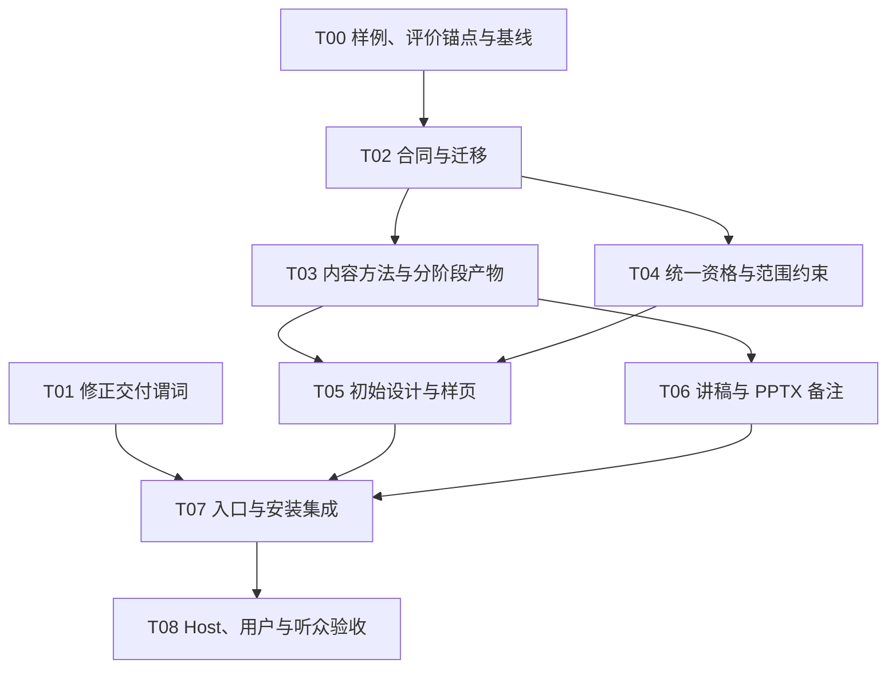

# Deck Master 内容协作与交付语义 v1.2

## 当前迭代入口：V1.0.0-RC3

2026-10-14 起，本包未完成交付与内容质量 R2 合并到 [RC3 开发计划](../deck-master-v1.0.0-rc3/README.md)，按 RC3-00～RC3-05 执行。T03/T04 修复结果先接收为联合开发基线；原 T00–T08、AC/CQ 与本文产品裁决保留。RC3 当前为规划，正式开发基线尚未接收，不能把历史实现/CI 或本次文档修订当作 RC3 验收通过。

状态：**可执行开发规范 / 待实现与验收**。日期：2026-10-12（Asia/Shanghai）。

本包把 PR106 的原始审计、后续产品审查和两份外部评审合成为一套开发任务。下文的 MUST/必须、默认值、接口和退出条件是本增量的设计裁决，不是对当前能力的描述。写入本包不代表实现完成、业务验收通过、安装切换或发布获批。

本次变更仅交付文档。开发代理拿到实施任务后，按 [RC3 执行卡](../deck-master-v1.0.0-rc3/TASKS.md) 接续，[TASKS.md](TASKS.md) 保留原能力与验收责任；不得把“已有开发 spec”理解为本次对产品代码、真实客户生产或合并的授权。

## 2026-10-13 内容质量修订入口

已补齐 [完整迭代方案](CONTENT-QUALITY-ITERATION.md)、TASKS §1.1、ACCEPTANCE §1.2/§1.2.1/§4.1/§8 与 CONTRACTS §11.4.1；锚点统一到 ACCEPTANCE 的唯一失败分级。这里只完成文档修订；历史产品结果不因文字更新升级为通过。当前修订基线与新增条件状态见方案；产品实现等待后续明确任务，不改动下方原始编写基线的历史事实。

## 1. 要解决的问题

用户给出一句模糊请求后，系统可能自行补出内容方向并直接制作整套 PPT。内容与用户目的偏离时，用户需要重新搭建主线。当前 Runtime 的版本、任务、调用额度、候选和工程检查应保留；本增量补上前期专业产物、可复用的用户决定、限定范围与前置内容评价。

成功标准同时包含：范围没有被扩大、内容有证据且符合任务、用户可以低成本判断方案、最终文件忠实承载约定内容。生成文件、结构合法或多一次确认均不能单独满足本目标。

## 2. 实施基线

| 项目 | 固定值与含义 |
| --- | --- |
| 代码基线 | `af9fd7a6b4d08f753d2f16536a03f386384f49d2` |
| 本包编写前 PR106 head | `9797f9e25fbc20880752933be6324b879783603b` |
| PR106 base | `main`，核实时仍为上述代码基线 |
| 本包编写前 PR 范围 | Open / Draft；1 个提交；12 个新增文档/证据文件；+1531/-0；无实现修改 |
| 当前执行结果 | 本轮未运行产品单测、真实 Host、生图、PPT 编译或客户项目；本包中的案例是合成设计样例 |

实施者在 T00 **重新核实** base/head、本地工作树和实际安装版本。若 main 已变更，列出本包涉及的文件差异并调整任务卡；不能沿用这张表声称最新代码未变。源码定位与外部评审裁决见 [RECONCILIATION.md](RECONCILIATION.md)。

## 3. 本版已经裁决的产品选择

| 决定 | 本版规范 |
| --- | --- |
| 公开 Skill | `deck-master`、`deck-content`、`deck-design`、`deck-review`；同一个 Runtime 和项目状态 |
| 独立写作 | Content 提供 `plan_only`、`write_only`、`speech_only`、`content_full`；不能把 Writer 职责藏回一次完整 compose |
| 自动推进 | Master 的运行模式；只推进有效委派与范围内的动作；不增加独立 autopilot 状态机 |
| 内容权威 | Narrative 管论证；ContentPlan 管页面职责、映射和预算；Page 管上屏正文和逐页 speaker notes；可阅读文档是投影 |
| 已确认稿 | 直接进入相应下游；只做适用性、忠实性和新冲突检查；不倒推伪造“已确认 Narrative” |
| 口播 | 明确 live 默认 cues；明确逐字稿才用 verbatim；read_alone 默认 none；未明确模式不凭默认 live 生成口播 |
| 双用途 | mixed 必须说明主用途；需要两个优化版本时共享论证、分别规划与验收，不把一个版本标成两种用途都通过 |
| 内容与设计 | 篇幅/密度/表达可行性先迭代；真正生产绑定确定 Page/recipe 版本；设计不能静默改论据 |
| 样页 | 按未覆盖风险选择代表页；只试一页就只生成该页；采用候选、接受风格维度和授权整套是不同事实 |
| 指令来源 | 默认支持可追溯的 Host 转述；如实标 host_attested。CLI 命令或 actor=user 不提升为 verified_user；强核验策略要求真实适配器 |
| 新论证前置审查 | full_deck 默认独立模型或人类内容审查；能力缺失给具体缺口。明确降级可用 Host 自审，不冒称独立 |
| 人类专业复核 | 原 `professional_review_required_for_delivery=true` 的人类语义保留；独立模型不能替代 |
| 新建入口 | CLI / Studio / Host 默认统一 workbench.v3 + 本增量能力；旧格式不能作为新门禁的旁路 |
| 迁移 | 版本化、显式写入；历史可以查看/审阅导出；旧字符串决定不自动升级为授权；恢复不复活撤回 |

这些选择替代原审查包中 D01–D06 的开放候选，具体语义以 [SPEC.md](SPEC.md) 和 [CONTRACTS.md](CONTRACTS.md) 为准。它们仍需按验收实际证明；若被用例推翻，应修订本包并保留决策记录，不能由实现者私下改另一套默认。

## 4. 阅读顺序与文档职责

1. 本 README：范围、基线、决定和执行入口。
2. [SPEC.md](SPEC.md)：用户流程、专业方法、职责、停顿与质量政策。
3. [EXAMPLES.md](EXAMPLES.md)：四个合成材料包、流程轨迹、完整六页内容样例和失败锚点。
4. [CONTRACTS.md](CONTRACTS.md)：唯一事实源、数据约束、接口、资格判定与失效。
5. [MIGRATION.md](MIGRATION.md)：版本边界、旧项目、安装和恢复。
6. [TASKS.md](TASKS.md)：T00–T08 的实现顺序、落点、依赖和交付。
7. [ACCEPTANCE.md](ACCEPTANCE.md)：每项 AC 的唯一责任、可观察结果和分层证据。
8. [RECONCILIATION.md](RECONCILIATION.md)：采纳、修正、拒绝的评审建议与固定源码证据。
9. [VALIDATION.md](VALIDATION.md)：本次文档验证，与未来产品验收分开。

遇到冲突按职责修订对应文档：产品意图由 SPEC 决定；机器字段与接口由 CONTRACTS 决定；兼容策略由 MIGRATION 决定；是否完成由 ACCEPTANCE 决定。README、任务卡和案例必须同步。旧 R1–R6/CC01–CC28 只保留审计定位作用，不能与本包并行执行。

## 5. 开发依赖

T01 可与 T00 并行；T02 必须先通过 T00 的产物可审查性检查。T03/T04 可并行开发，启用生产路径前必须共同通过门禁回归。T05/T06 可并行；T07 的适配器可提前设计，但不得先实现一套私有批准状态。T08 的用例和记录模板在 T00 就准备，不等最后才设计评价。

## 6. 给开发代理的执行入口

收到实施授权后：

1. 读仓库 `AGENTS.md`、本包 README、T00/T01 及其 AC，核实基线和用户工作树。
2. 在隔离开发分支/工作树保存实现，保留用户既有修改和所有历史项目。
3. 先完成 T00；T01 可以作为单独的小变更并行。不要先把 R1–R6 原草案翻译成代码。
4. 每张卡提交：改动文件、实际命令/环境、测试结果、对应 AC、仍未验证事项。不能用 mock、fixture 或文档截图冒充真实 Host/样页/桌面证据。
5. 产品/合同/方法新增只在本包定义范围内进行；若发现约束相互不可满足，给出失败用例和拟调整条款，再修订 spec。
6. 所有卡工程通过后，仍需 T08 的实际使用证据，才能提议安装切换/发布。没有真实人类阅稿，不显示 human-approved。

需要 Codex 在目标环境核验：依赖和安装、现有测试基线、writer 兼容、完整 Host 任务链、真实样页、PPT 备注与回读、真实浏览器交互。本文档没有替这些检查签字。

## 7. 明确范围

本增量包含前期内容协作、首次设计试作、限定推进、语义审查、备注交付、跨入口统一、必要迁移和验收。保留 Store/CAS、Task/call allowance、candidate/changes、style recipe、生产核心和工程回读。

不恢复旧 18 Skill Suite、旧 Runtime/Workflow 命名空间、强制库/私有 backend、企业审批平台或长期记忆系统。不以本任务实施客户项目，不把公开 Skill 数量或模型角色数当质量证据。
