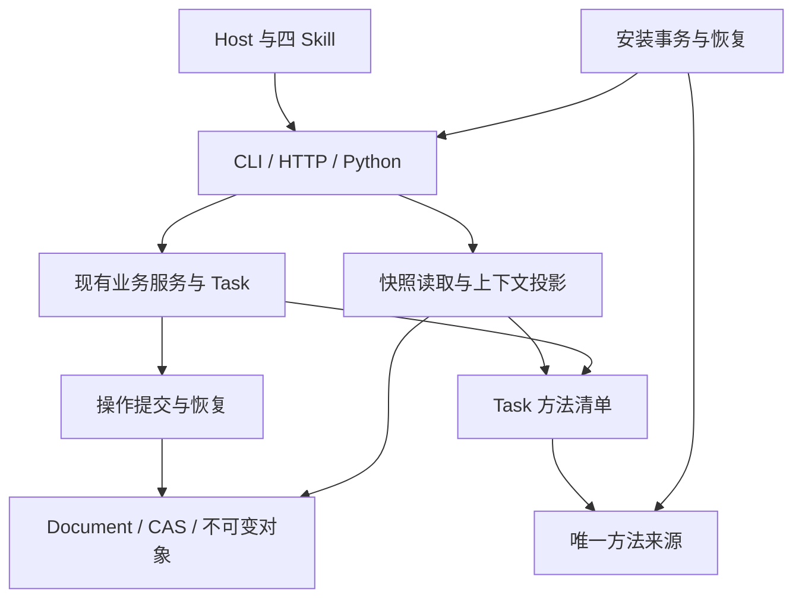

# 03 架构、接口与兼容合同

## 1. 目标架构

下面表示本轮目标责任关系。大部分组件已存在，N1–N4 在现有边界内补齐实现；图不代表新增功能已经可用。

- 业务服务继续决定任务、scope、采纳、调用和交付规则；适配器负责传输与旧协议形状。
- Document/current 与不可变对象继续提供项目事实。N1 resolver 是读取操作事实的唯一公共内部边界。
- N3 resolver 是任务方法依据的唯一来源。N4A 可以改变正文传输方式，不能改变清单或业务要求。
- N4B 索引是可丢弃的派生物。安装事务仅描述 release tree 与链接操作，属于安装控制面。
- N6 改进方法正文和被证据指向的布局行为；其运行结果仍按现有 Task/Review/文件链保存。

## 2. 跨卡接口冻结表

接口合同冻结后才允许相关写入代码并行修改。下列内部函数无需成为独立 SDK。

| 接口 | 最终定义 Owner | 消费方 | 约束 |
|---|---|---|---|
| I01 `operations.resolve_operation(store, operation_id, head_revision=...)` | N1 | N1 入口、N4B、既有 Store 回执 wrapper | 固定 head；三态 committed/not_found/unknown；返回原 receipt/result；纯查询不读素材、不写索引 |
| I02 普通 inputs.update 摘要及原成功投影 | N1 | CLI、旧 HTTP、service、operations show adapter | 旧 ID 和旧摘要不缩窄；新摘要纯解析；不同操作族同 ID 冲突 |
| I03 eligibility artifact/control 固定读取 | N1 | eligibility.describe、collaboration_api eligibility | 复用 snapshots；只读、同项目、已提交 ancestry；空 revision 不回退 current |
| I04 安装持久事务及 transaction-id | N2 | activate、rollback、安装恢复/诊断 | request 与实际 old/new targets 固定；先意图记录后副作用；中断后重验实际状态 |
| I05 `resolve_task_methods(task)` 的有序 manifest/basis | N3 | task_summary、read_task_methods、Skill reader、N4A | 唯一清单；路径、hash、顺序和 release 真实；旧 Task 不静默增加方法 |
| I06 Task 持久方法依据与校验政策 | N3 | tasks、content_production、models、合同镜像 | schema 为历史兼容可选；新派发 producer 必写；首次相关新写提升 rc4-content.v1；旧 writer 拒写 |
| I07 `work_context.v2` | N4A | methods 读取、可协商的工作单投影、Host adapter | read_protocols 能力声明；full 默认；v1 不变；副作用入口先验证协商 |
| I08 版本与安装方法身份 | N5/集成 Owner | N2、N3、N6、installed gate | 最终候选只统一 bump 一次；实际打包字节与声明一致 |

N4 不引入与 I01/I05 同义的 resolver。N5 不定义另一套方法副本。N6 修改方法字节后，相关派发、hash 与安装检验需跟随更新，不能把旧 Task 重标为使用了新方法。

## 3. 操作恢复合同

### 3.1 必须区分的事实

| 情况 | 规范结论 | 后续动作 |
|---|---|---|
| current 可达提交含有效原子 receipt，族和请求摘要一致 | committed | 取回原结果；不重复执行、不再读素材 |
| 已核验完整 ancestry 无该 ID | not_found | 先完成 N1 的 legacy 日志占用/重放检查，再进入新请求准入/准备；锁内重复检查与 CAS |
| 找到旧 input_update 提交，只有兼容日志 | resolver unknown + legacy_receipt_only | 由 N1 旧日志 adapter 验证原绑定；不得称为新原子协议提交 |
| 已存在带该 ID 的旧历史提交，但日志缺失；或日志存在却损坏/无法证明原请求 | unknown / operation_unverified | 保持事实不明，不建议直接换 ID/base 重做 |
| 旧 log-only no-op 日志完整 | resolver 仍为 not_found；adapter 可返回 legacy replay / legacy_recorded | 验证原日志与其所指可达 revision，保留 ID 占用，不新建回执、不升级为原子 committed |
| 旧 log-only no-op 的唯一日志全部丢失且 ancestry 无该 ID | 与从未使用该 ID 无法区分 | 不承诺可恢复或伪造旧结果；按 N1 已明确的旧数据能力边界处理 |
| 历史损坏、缺失、跨项目或无法读取 | unknown 或现有结构化错误 | 修复实际读取/历史问题；不能解释为不存在 |
| 同 ID 异族，或按该回执原摘要合同确认 payload/base/上下文不一致 | conflict | 严格新 base/上下文绑定仅适用于新回执；旧日志未记录的绑定不补造，不自动转换操作族 |

`inputs.update` 与 `content.inputs` 是不同摘要域和返回外壳。可以在同族的 CLI/Python/HTTP 间重放同一请求，不把同 ID 的跨族请求视为同一操作。中性 `operations show` 可以读取两者，但必须保留真实来源、原提交版本与当前版本的区别。

### 3.2 no-op 的显式行为变化

为了让新普通输入操作的“未改变业务内容”结果也能在丢缓存后恢复，允许提交只承载这次回执的 revision，并继续返回 `status=unchanged`。这会推进 revision，但不能更改 Page/输入 basis、派发新 Task、增加模型调用或使未变内容失效。

旧历史 no-op 不补造 revision。所有依赖“unchanged 一定意味着 revision 不动”的现有调用方需要定向兼容检查。此变化属于本轮明确设计，不得藏在性能优化或文档修订中。

### 3.3 索引的可信边界

冷进程从 canonical ancestry 建立可信覆盖。磁盘提示有 checksum 也不能证明某 ID 不存在。热态需要检查项目、head 和文件签名；发现变化即失效。完整负查询的热态目标为 0 次历史 JSON 解析，正查询最多重新解析命中 Document 1 次，但仍可能有 O(H) 文件 stat。

纯 resolver 不发布持久缓存。后置缓存写失败不能把已提交结果改成失败；不清理旧 operations 日志来腾索引路径。

## 4. 存量 Task 与内容政策

### 4.1 为什么需要持久边界

当前 Task 记录 release 摘要，但工作单会根据当前 selector 重新计算方法清单。新增 Review 规则后，单靠 release 名无法精确说明旧任务当时用了哪些文件。

本轮在现有 Task 内增加两个字段；schema 的 optional 仅用于历史兼容，新派发 producer 自动写 manifest，实际新 argument 写入必须冻结 policy：

- `method_manifest`：有序的 `id/relative_path/sha256` 条目。
- `content_validation_policy`：显式的内容校验政策，目标值 `argument-connectivity.v1`；适用对象与写点见 N3。

不新建 Task 类型、另一份当前状态或独立政策数据库。schema 的 additionalProperties 边界、方法总 hash、writer feature 检查和既有唯一镜像必须一起更新。

### 4.2 兼容矩阵

| 对象/动作 | 规定行为 |
|---|---|
| 新 Task，使用新 manifest 或新校验政策 | 同一事务保存字段，并要求至少 rc4-content.v1；不能先写新字段后才检查 writer |
| 旧 Task，manifest 缺失但冻结 RC3 规则与原 digest 能证明一致 | 按旧依据读取；不自动“补全”新的 Review 方法 |
| 旧活动 Task，需要新方法或校验政策才可执行新工作 | 报告 basis_changed，使用既有正式重新派发/失效机制；沿用原授权范围，不凭升级扩大授权 |
| 已提交旧结果的精确重放、历史读取 | 保留原 receipt 和当时语义；不重做、不追溯判错、不自动升级项目 |
| 新 argument proposal 提交 | 按任务已声明政策校验，在 put 对象/Task完成/Document提交之前拒绝结构不合格结果 |
| 升级前已被 committed Task/receipt 证明接纳的旧 proposal，升级后首次采用 | 原对象未改、当前 scope/decision/CAS 有效时沿原语义；不追溯新 policy，也不冒称新策略通过。新提案、改写或孤立磁盘对象不能享受此例外 |
| 仅使用 work_context.v2 读取 | 不提升 writer、不修改 Task、不制造消费证据 |
| 旧 writer 打开含新持久事实的项目 | 在新写入前明确拒绝，保留原 bytes；不得静默丢字段或降级写回 |

论证连通属于结构必要条件。它不证明来源充分、推导正确或用户认可；framing、已导入确认稿映射和不同文体继续按其实际合同处理。教学内容不强制加入销售型 CTA。

新增 writer rank 时必须审查所有显式 writer 名称列表和 feature floor 判断。尤其不能使 `collaboration_required` 因遇到新枚举而反向放松既有规则。

## 5. 上下文读取与 Host 合同

### 5.1 协商

新 Runtime 在 `capabilities.read_protocols` 声明 `work_context.v2`。未请求新协议时仍返回 v1。新 Host 先读能力，不支持时主动使用 v1；显式不支持的协议不能偷偷降级。create/continue 若接受新读取参数，必须在任何业务写入前完成校验。

v2 的 schema 使用文件名 `work-context.v2.schema.json`、`schema_version=work_context.v2`。这是只读响应合同，不写入 Task.protocol_version、Document 或生产授权。

### 5.2 正文、引用与证据

- `full` 为默认：必需方法与 source extract 正文完整返回，各唯一内容 hash 在响应中只一份。
- `delta` 只省略当前 Host 可以实际取回的相同字节；不可观察会话或上下文代次时按冷上下文处理。
- `manifest` 显式返回目录与取回位置，`context_ready=false`；不能当作已完整提供生产上下文。

Task 清单、原始来源目录、正文、notes、限定、原图与尺寸、设计/字体/物理约束均须无损保留或能按精确版本解引用。不能因为某来源尚未被 Page 引用就删掉该来源的必读义务。正文传输状态不等于阅读、应用、独立审查或授权事实。

## 6. 安装事务与项目回退的区别

N2 的事务固定这次请求的 prefix、release、old/current/previous 与四 Skill 的目标/所有权信息。journal 在持久副作用前写入；每次恢复重新检查实际链接，不能只信任“步骤已完成”的文字。

`activate/rollback --transaction-id <UUIDv4>` 是精确重放/恢复入口；相同 ID 不同绑定要拒绝。无 ID 时未完成同请求自动接续；已经完成的 rollback 再无 ID 调用保留旧语义，可切回另一版本。旧 transaction 精确重放返回原完成事实；若其后另有安装切换，当前安装状态作为独立观测说明，不能把原结果当作当前仍生效。

安装回滚成功不意味着旧程序能写入已升级项目。若项目已有 rc4-content.v1，回滚到 RC3 后旧 writer 应拒写；不能为了使安装 rollback 看起来可用而降低项目 floor。新功能开发首先在隔离项目验证；使用复制项目或向前修复处理产品回退，不自动改写用户历史。

## 7. 文档与 schema 真源

| 内容 | 唯一活动来源 | 本轮规则 |
|---|---|---|
| Runtime JSON schemas | src/deck_master/resources/contracts/ | N3 修改现有 task/document 相关合同；N4新增读取合同 |
| 既有 schema 的 spec 镜像 | test_package_boundary 已登记的唯一对应镜像 | 字节同步，不重复创建新镜像 |
| 新 work-context v2 镜像 | docs/specs/deck-master-next-iteration-20261019/contracts/work-context.v2.schema.json，仅这一个 | 注册 models.SCHEMA_FILES 与镜像目录；集合相等/无重名继续检查 |
| 专业方法正文 | skills/deck-master/references/ | 四 Skill 用链接/真实 path/hash，安装由既有打包流程同步 |
| 本轮判据 | task-cards/N*.md 的 AC 表 | 其他文件引用，不复制可编辑判据 |
| 当前执行状态 | 一个候选的一份 execution-ledger.json | 报告和 README 只投影，历史保留时点 |

本包交付阶段不附伪装成当前可用产品 schema 的 JSON 文件；实际 schema 由开发任务在仓库按规范完成并验证。

## 8. 对外可观察错误与状态

优先复用已有错误类型与 code；必须新增的 code 在对应任务卡和入口测试中登记。最低需要稳定表达：

- 操作恢复：冲突、无法验证、暂时不可用，以及原/当前 revision。
- 安装恢复：同 ID 不同请求、外部路径冲突、事务未完成/需恢复、已验证完成。
- 方法与内容：basis_changed、方法不存在/损坏、连通校验失败的具体节点/字段。
- 读取协议：read_protocol_unsupported、manifest/缺资源导致的 context_ready=false。

错误通过程序可读字段说明下一步，不能仅返回裸字符串或 exit code。不得把安装版本、协议支持、cache offer 或文件读取事实当作生产批准。

