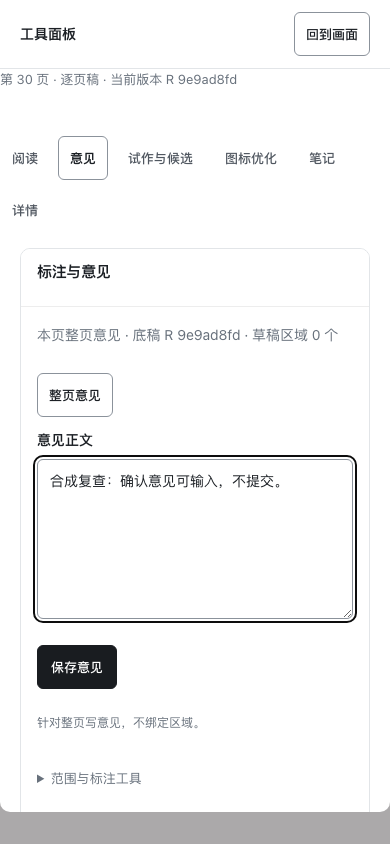
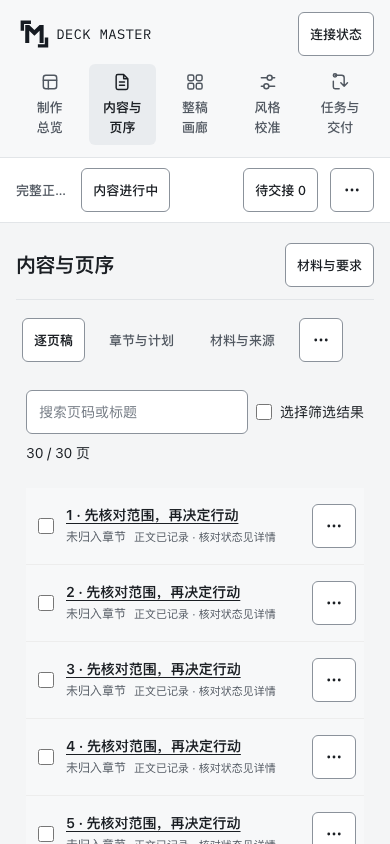
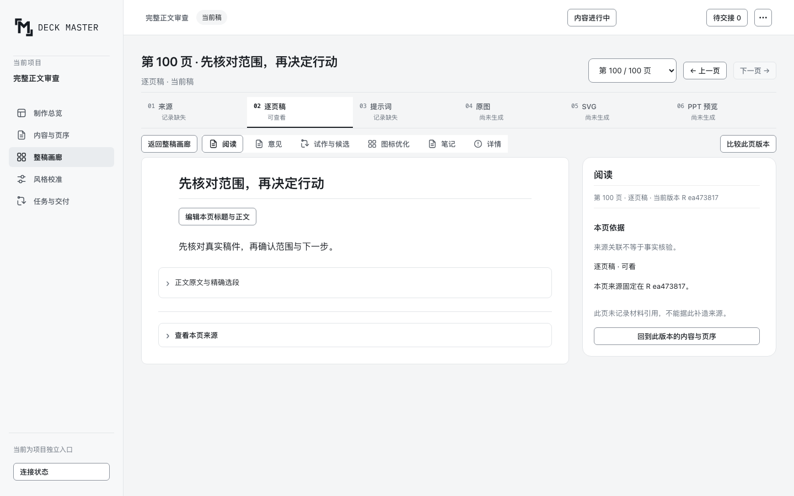
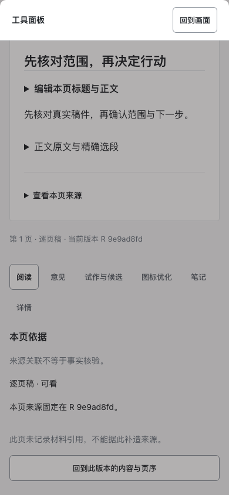
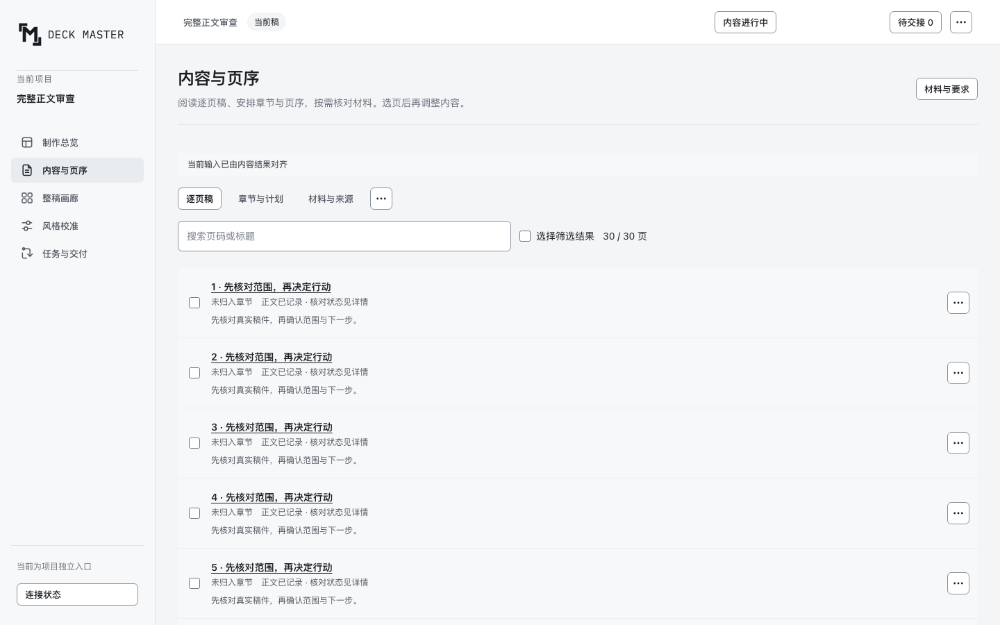
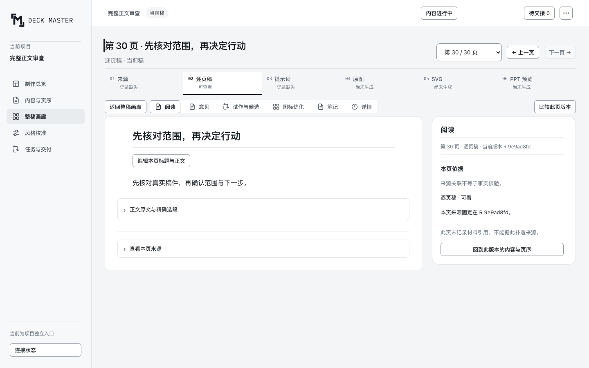
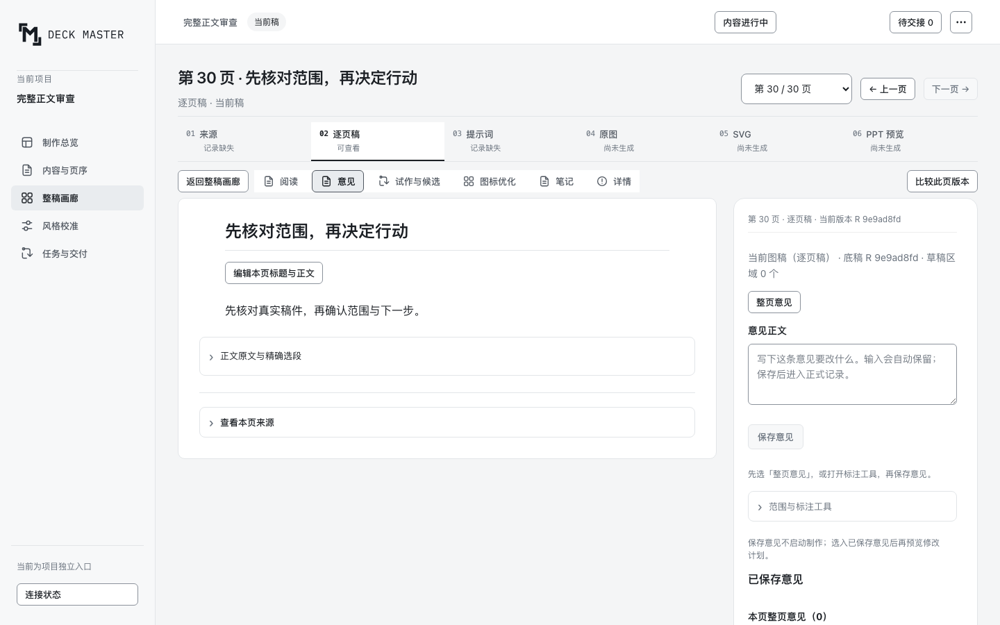
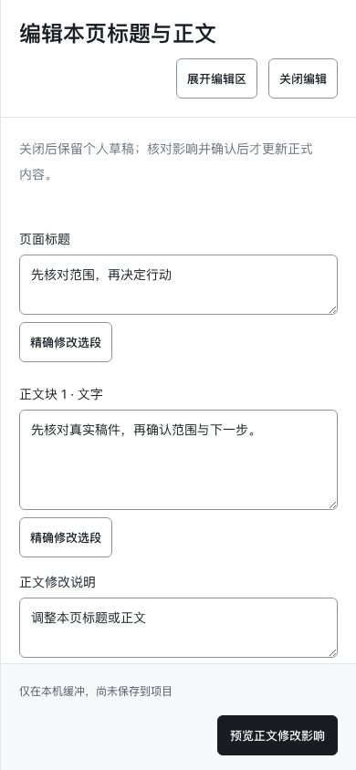

# 标注收起边界补充复验 · 21ccc843

**本次小修复验通过：主动点/框标注在收起工具后继续有效，普通关闭仍回阅读。** 绑定 `21ccc84389662d2b7326bc02e6f0bd2e22f6bb2c`，已核对测试时 `page-workbench.js` SHA-256 与提交内文件完全一致（`0474d3c0ae78f432a40a0aa46e6e495fc21ad7b2a74d32e788fc0c29a2e7fcc3`）。其余测试与文档未提交内容不计本次产品范围。

- Studio与v2分别选择点标注/框选，共4条真实浏览器路径：1440进入并明确选模式，切1024收起工具，overlay仍接收指针；在画布实际点/拖后均出现1个未保存标记。重新开工具，意见文字保持；明确切“详情”后overlay停止接收指针。
- 两入口390触屏另验2条普通路径：默认意见输入隐藏，打开工具再普通关闭，恢复阅读，overlay为none。没有把显式标注与普通关闭混为一谈。
- 未保存或提交意见；全部独立合成数据。pageerror为0，浏览器与服务均已关闭，无产品改动。文本选段模式未在此小范围追加真实操作，不把代码分支存在当作已验证。
- 初次脚本采用同一入口处理两套UI，产生导航超时（v2窄屏入口是“工具”；Studio详情需先关闭modal），随后按实际入口更正；这些脚本失败不是通过记录，也没有修改产品解决。

[机器记录](annotation-dismiss/metrics.json) · [Studio框选证据](annotation-dismiss/studio-框选模式.png) · [v2点标注证据](annotation-dismiss/v2-点标注.png) · [Studio普通关闭](annotation-dismiss/studio-ordinary-close.png) · [v2普通关闭](annotation-dismiss/v2-ordinary-close.png)

---

# 最终定向复验 · c10f706b

**结论：原 DR-01、DR-02 及二次复审新增 DR-R01 均已关闭。本声部当前未保留 P1/P2。** 以下原945eef0a发现完整保留，不能误读为最终HEAD仍未修复。

最终定向复验 HEAD：`c10f706bb1bf6e539013771eedd5a50f828d7058`。使用同一份合法合成正文fixture、独立真实Chromium，在v2 390触屏、Studio390触屏/1280触屏/1440普通指针检查。

- **DR-R01 fixed**：v2窄屏点“工具”后，意见区实际挂入dialog；点“整页意见”后可输入，读回输入完全一致，“保存意见”可用。仅验证可操作，未提交；随后清空合成输入，点“回到画面”关闭dialog，恢复默认阅读、意见输入隐藏；再次打开仍可操作。
- **行高一致性备注 fixed**：两入口实际段落都为16px/28px。
- **分页未回退**：30/30标签完整，实际文字81.85px，v2窄屏可用124px、Studio窄屏98px、Studio桌面108px；触屏分页78×44，桌面普通78×32；末页下一页禁用，上一页可用；所有本次视口无横向溢出。
- 浏览器pageerror为0。浏览器与服务均已停止，未改产品。100/100的完整截图属于前一轮945eef0a证据，本次最终定向复验未重复100页，不能更改其SHA。

本次机器记录：[c10f706b/metrics.json](c10f706b/metrics.json)。移动六项工具标签换行仍作为P3精修观察，未影响本次功能闭项；视觉认可仍由用户判断。

---

# PR188 design-review 二次浏览器复审

固定 HEAD：945eef0ab38b0e811e9924f45b66ac0e2b6906a6。结论：**DONE_WITH_CONCERNS，原2项已修复，新增1项P2，另有P3一致性备注**。本轮只读，未修改产品、未发布 Review、未合并。

## 原问题关闭

| 项目 | 状态 | 新鲜浏览器证据 |
|---|---|---|
| DR-01 窄屏内容工具堆叠 | fixed | 390×844，无banner正式合成正文。首行从y683前移到y488，前三行77px高，第三行底719px；首屏4条完整行。材料与要求折叠可展开，查看输入判断仍可达。 |
| DR-02 桌面页码select裁切 | fixed | 1440普通指针及1280触屏，select宽160、可用108px；“第30/30页”宽81.85，“第100/100页”宽94.62，闭合标签完整。390 select150可用98，30/30完整。 |

## 新发现 DR-R01 · P2 · v2窄屏工具弹窗空白

复现：30页有正文项目，`/v2/`，390×844触屏，进入单页默认阅读，再点“工具”。

实际：打开的 modal 只有“工具面板”和“回到画面”，没有阅读、意见、试作与候选等内容。这些内容仍留在灰色且被 modal 屏蔽的底层页面。用户打开工具后反而无法操作工具。浏览器没有pageerror，不能靠控制台无错判断通过。

期望：把工具内容放入打开的modal，或提供与Studio一致的可操作工具入口；不能打开空壳。该项已立即上报主Agent，等待统一修复后再做定向复核。

## P3 一致性备注

Studio实际正文为16px/28px；同一份正文在v2为16px/26.4px。两入口的分页已统一，但正文行高尚未完全统一。v2不是本次设计主工作台，这不升级为P2；若完整方案承诺两个入口统一16/28，应补齐。

390单页新增“阅读”切换后共6项，试作与候选折成3行，控件行高约72px。文本仍完整、可点击，未构成P1/P2，但后续精修应考虑减少标签换行，避免回到拥挤的工具条。移动内容列表隐藏正文摘要以保留多行，章节和事实状态仍在；桌面可见真实正文预览。未归入章节是本fixture缺少章节关系的真实状态，没有把它误判为实现缺失。

## 其他实际验证

- Studio1440/1280触屏/390、v2 390分页文字均保留；触屏按钮78×44，桌面普通78×32；末页下一页禁用，上一页可用；无横向溢出。
- Studio单页默认“阅读”，意见输入不显示；实际点“意见”后输入区出现，选中底色与边框可辨。
- Studio390正文编辑抽屉可打开，标题、原文、修改说明、关闭、预览动作均可见；未提交改动。
- 内容桌面增加章节、状态、真实摘要，标题链接/摘要/事实状态层级明确，较前版裸标题列表更易读；不把合成缺失来源冒充产品错误。
- 30页与100页使用public_project + manuscript_page合法创建的独立合成fixture，无模型调用和客户数据；Chromium真实截图与计算样式，pageerrors为空。独立浏览器与WorkbenchServer均已关闭。

机器记录：[metrics.json](metrics.json)。截图为945eef0a，不以旧CI或旧截图替代当前验证；没有覆盖全部14种pressed控件全组合、真实Host质量、外部返修或用户最终认可。原生下拉popup不属于本次标签完整性声明。
