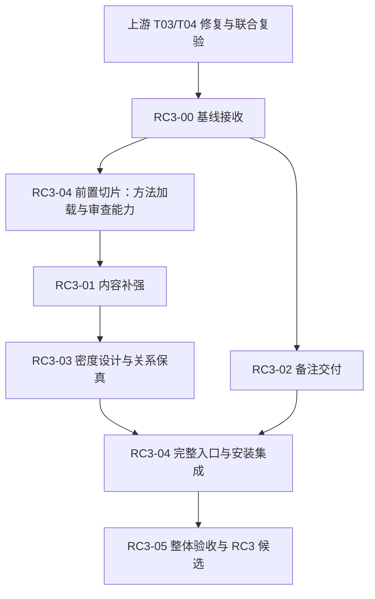

# Deck Master V1.0.0-RC3 开发计划

2026-10-18 用户纠正：交付只要求任务、内容和实际成品可用。不设置听众反馈、固定用户试用人数、真人计时或必跑对照实验。原实验记录保留历史，不再作为默认结项门槛。

代号：**RC3**。目标版本：**V1.0.0-RC3**。规划始于2026-10-14；2026-10-18更新。当前状态：本轮适用检查已通过，六张执行卡已收口。可执行候选 `7d772f6f`（`1.0.0rc3`），基线 `PR120/main@0abf66f7`。详见[当前收口报告](../../reports/rc3/closeout-20261018/README.md)与[唯一执行台账](../../reports/rc3/evidence-ledger.json)。PR122 为本次修订的交付分支；合并、正式发布和真实 HOME 激活另行处理。

本轮将内容协作 v1.2 尚未完成的交付，与内容质量 R2 的补强合成一次迭代。用户无需先等旧 T05–T08 完成，再启动另一轮。先接收 T03/T04 修复后的联合基线，再完成内容、备注、设计、入口安装和真实验收。

## 1. 目标与交付

从原始材料与明确用途形成业务具体、论证成立、逐页有增量的完整稿；按有效范围制作保留内容关系、可编辑的页面与适用备注；CLI / Studio / Host 和四 Skill 使用同一 Runtime、方法与控制；在实际候选安装及真实任务上验证。

学习 CyberPPT 的材料分析、论证结构、内容密度、视觉承载、制作与质检方法。成品不堆无效制作注释或内部证据索引。密度不是增加字数，内容完整也不是保留所有原始材料。

本轮延续原生 SVG 编译、Store/CAS、任务、候选与费用账本；完成现有协议与产品链路，不另建批准数据库或编排状态机。发布和日常安装激活仍按实际授权执行。

## 2. 正式启动条件

**RC3-00 接收通过后，RC3-01～05 的产品实施进入本轮开发。** 此前可整理案例、测试输入和规范，不以当前修复中的工作树为冻结候选。

接收要求：
1. 上游 T03/T04 的六项审查问题 RF01–RF06 均有正式连续路径的处置与修复后证据。
2. 最终联合代码、测试、远端 CI、必要审查对应同一确定版本；旧提交绿灯不覆盖后续修复。
3. 固定 base/head/tree、方法/合同与候选安装身份，并对本轮规范版本留可核对引用；现有用户修改保留。
4. 补齐新接口与遗留移交清单，明确可复用证据和仍为 NOT_RUN 的层。
5. 冻结共同基线 A 的身份，供需要时的内部诊断；不以额外效果实验作为基线或交付前提。

优先接收修复合并后的 main；暂不合并时可接收通过复验的固定 integration SHA。PR 编号全部显示已合并、代码已提交、单卡 CI 通过，都不能单独替代联合基线接收。RC3-00 不另起分支重复修复上游问题。

上游 RF01–RF06 已随基线接收关闭；原规划取样与接收身份保留在 [BASELINE.md](BASELINE.md)。最终候选另按当前提交、安装、方法和实际检查结果登记，不把历史取样作为当前待开发事项。

## 3. 执行入口与编号

本轮唯一执行编号为 **RC3-00～RC3-05**。原 T00–T08 保留能力边界与验收责任，37 项 AC 与 13 条 CQ 保留原编号；I01–I08 保留增量追踪。此前讨论中的 R2-00～05 建议编号由本包替代。

- [TASKS.md](TASKS.md)：卡片总表、顺序、并行与共享改动规则。
- [task-cards/](task-cards/README.md)：六张可接续执行的完整任务卡。
- [ACCEPTANCE.md](ACCEPTANCE.md)：阶段出口、最终关闭条件和证据要求。
- [TRACEABILITY.md](TRACEABILITY.md)：37 AC / 13 CQ 到六张执行卡的唯一汇总位置。
- [traceability.json](traceability.json)：可校验的同一映射，不包含独立通过状态。
- [evidence-ledger.template.json](evidence-ledger.template.json)：未来实施时复制为唯一候选验收台账。
- [SOURCE_GUIDE.md](SOURCE_GUIDE.md)：继承规范、历史诊断和交付包来源。
- [VALIDATION.md](VALIDATION.md)：本次规划的静态检查及未运行边界。

## 4. 顺序与并行

内容方法与备注编译可并行。设计的无调用可行性与脚手架可提前准备，真实代表页评价等待合格正文。RC3-04 分前置/完整两个切片，前置切片不依赖 RC3-01 完成，避免方法消费与内容验效互相等待。RC3-05 的输入与协议现在准备，最终验收在完整集成后汇总。

## 5. 规范权威与完成口径

专业语义、合同、兼容与失败分级继续来自[内容协作 v1.2](../deck-master-content-collaboration-v1.2/README.md)。本包调整执行组织、交接与目标版本，不放宽原要求。唯一 F0–F3 定义为[原 ACCEPTANCE §1.2](../deck-master-content-collaboration-v1.2/ACCEPTANCE.md#12-统一失败分级)；RF01–RF06 是审查问题编号，与内容失败等级分开。

每张执行卡区分“工程交接出口”和“最终 AC 关闭”。后续卡可以提供真实使用证据给前序能力 Owner，避免要求卡片全部专业验收先完成才允许集成。通过、失败和未运行只在同一候选台账登记；映射表和任务描述不另维护一套 pass。

RC3 计划完成不代表 V1.0.0-RC3 已生成。源码、包元数据、安装与候选清单的版本一致性归 RC3-04，最终证据与候选结论归 RC3-05。正式 1.0.0、发布、合并与安装激活均不由本次规划自动执行。
