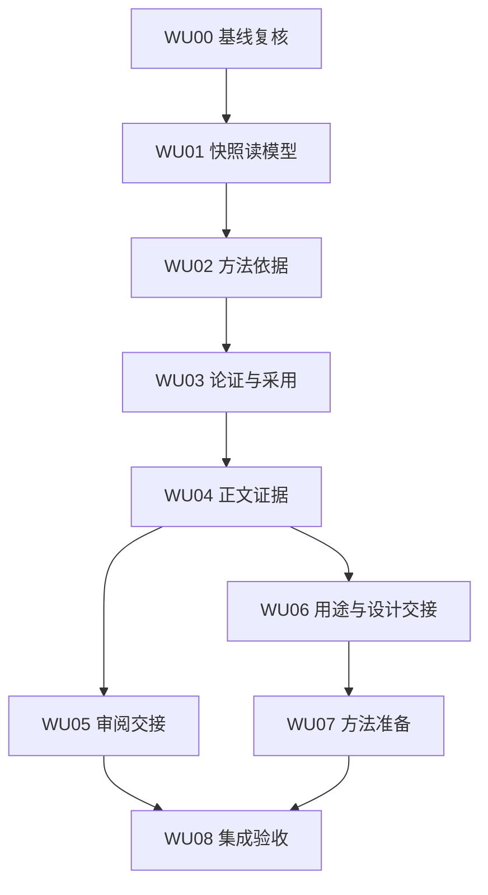

# 开发任务卡与依赖

9 张卡。每项 AC 的最终负责卡唯一；实现者在执行账本填写姓名/Agent及准确 SHA。默认串行推进，本规格不自动启动子 Agent。

依赖图表示数据和验收依赖，不授权并行改共享文件。默认完整 WU01–WU08 放入同一个独立新 Draft PR；A（WU01–WU05）与 B（WU06–WU07）仅为内部增量，WU08 在最终集成 head 收口。确需拆 PR 先说明原因，不擅自拆；均以 PR127 最终可用基线为前置。

## 共同行为

每卡先读取最终基线对应模块，再做最小改动；有同等能力直接复用。运行本卡AC和实际受影响的既有回归，不预设测试条数。不得为通过检查删掉原比较/来源/范围断言。新增模块名是建议落点；采用现有合适模块时更新文件表，不改功能合同。

下面主要落点中，省略前缀的 Python 模块与 `resources/` 路径均相对于 `src/deck_master/`；`tests/`、`docs/` 路径相对于仓库根。

## WU00｜启动与差异复核

- 依赖：PR127完成门槛G0。
- 输入：G0门槛和最终RC5源码。
- 交付：执行账本、基线差异表；PR127未收口则只完成复核准备。
- 主要落点：本目录 BASELINE.md、execution-ledger.json（实施时新增）。
- 边界：不修改PR127；不在旧主工作区上覆盖实现。
- 唯一负责验收：AC01, AC02, AC03, AC04。

**完成回执：**实现 SHA、实际变更路径、逐项 AC 结果、执行命令和证据位置、未验证事项。只有本卡完成不代表整轮通过。

## WU01｜固定版本读模型

- 依赖：WU00。
- 输入：最终schema、Store/snapshots、resolver。
- 交付：六类快照读API、capability、纯验证共享函数及HTTP/API验证；不可读判别 union、真实 Plan 关联与 Review 固定身份按 API 合同实现，不补造业务值。
- 主要落点：src/deck_master/content_insight.py（拟新增）；run_desk.py、web.py、snapshots.py、capabilities.py、models.py；resources/contracts/ui-*.schema.json（拟新增）。
- 边界：不写Document；不建立第二份论证或资源状态机。
- 唯一负责验收：AC05, AC06, AC07, AC08, AC09, AC10。

**完成回执：**实现 SHA、实际变更路径、逐项 AC 结果、执行命令和证据位置、未验证事项。只有本卡完成不代表整轮通过。

## WU02｜任务方法依据

- 依赖：WU01。
- 输入：WU01任务方法读模型。
- 交付：任务依据区、版本和当前可用性分层、缺口恢复入口。
- 主要落点：resources/static/v2/run-desk.js、api.js；必要的新轻量组件与studio样式。
- 边界：不自动continue或修复旧manifest；复用核实原任务。
- 唯一负责验收：AC11, AC12, AC13, AC14, AC15。

**完成回执：**实现 SHA、实际变更路径、逐项 AC 结果、执行命令和证据位置、未验证事项。只有本卡完成不代表整轮通过。

## WU03｜论证主线与方向采用

- 依赖：WU01, WU02。
- 输入：WU01主线读模型、现有decision/adopt事务。
- 交付：主线子区、零 Page 的固定 Plan 职责、current+candidate 固定比较、分离准入的方向决定/采用编排和部分成功恢复（API §4–5）。
- 主要落点：resources/static/v2/content-sources.js、collaboration-desk.js、routes.js；argument-reading.js（拟新增）；content_production.py的纯验证抽取。
- 边界：不能直接写confirmed；采用不启动生产。
- 唯一负责验收：AC16, AC17, AC18, AC19, AC20, AC21, AC22。

**完成回执：**实现 SHA、实际变更路径、逐项 AC 结果、执行命令和证据位置、未验证事项。只有本卡完成不代表整轮通过。

## WU04｜正文与证据联动

- 依赖：WU01, WU03。
- 输入：Page atoms/mapping与Narrative/source合同。
- 交付：正文定位、证据抽屉、固定深链和返回位置。
- 主要落点：resources/static/v2/page-workbench.js、content-edit.js、routes.js；content_insight.py的证据投影。
- 边界：不修改原来源/locator，不把方法示例当事实。
- 唯一负责验收：AC23, AC24, AC25, AC26, AC27。

**完成回执：**实现 SHA、实际变更路径、逐项 AC 结果、执行命令和证据位置、未验证事项。只有本卡完成不代表整轮通过。

## WU05｜审阅定位与修订交接

- 依赖：WU01, WU03, WU04。
- 输入：Review v1/v2与原content plan/commit。
- 交付：可定位审阅、原始字段完整表达、有界修订草稿和恢复。
- 主要落点：resources/static/v2/views.js、content-edit.js、business-operations.js；review-findings.js（拟新增）。
- 边界：范围不可从评论措辞猜测；不自动标fixed。
- 唯一负责验收：AC28, AC29, AC30, AC31, AC32, AC33。

**完成回执：**实现 SHA、实际变更路径、逐项 AC 结果、执行命令和证据位置、未验证事项。只有本卡完成不代表整轮通过。

## WU06｜用途文案与设计语义

- 依赖：WU01, WU04。
- 输入：既有brief/阅读方式和content_requirements。
- 交付：中性用途文案、可选提示、设计语义只读摘要。
- 主要落点：resources/static/v2/launcher-ui.js、content-sources.js、page-workbench.js；design_requirements.py复用。
- 边界：不新增永久语体枚举，不覆盖正文或用户brief。
- 唯一负责验收：AC34, AC35, AC36, AC37, AC38。

**完成回执：**实现 SHA、实际变更路径、逐项 AC 结果、执行命令和证据位置、未验证事项。只有本卡完成不代表整轮通过。

## WU07｜资源与案例准备

- 依赖：WU01, WU02, WU06。
- 输入：PR127 catalog/selection接口；WU01和WU02基础。
- 交付：method-library预览/正文接口、安全示例阅读、个人准备稿与核心生成交接文本；浏览与派发状态分离、真实 409 指纹冲突及始终 preparation_only（API §2/8）。
- 主要落点：src/deck_master/method_library_view.py（拟新增）、web.py、capabilities.py；resources/static/v2/method-library.js（拟新增）、drafts.js；method_resources.py只复用/小幅抽取。
- 边界：网页不带参执行continue；不做通用派发预览引擎或新MethodPlan。
- 唯一负责验收：AC39, AC40, AC41, AC42, AC43, AC44。

**完成回执：**实现 SHA、实际变更路径、逐项 AC 结果、执行命令和证据位置、未验证事项。只有本卡完成不代表整轮通过。

## WU08｜整体验证与交付

- 依赖：WU02, WU03, WU04, WU05, WU06, WU07。
- 输入：A/B全部已集成的准确head。
- 交付：源码/独立安装浏览器证据、范围回归、实际Host记录和交付报告。
- 主要落点：tests/rebuild/test_webui_content_insight_*.py（拟新增）；docs/reports/webui-content-methods/（实施时新增）。
- 边界：不把RC5文字探针当本轮Runtime E2E；不自动发布/激活HOME。
- 唯一负责验收：AC45, AC46, AC47, AC48, AC49, AC50。

**完成回执：**实现 SHA、实际变更路径、逐项 AC 结果、执行命令和证据位置、未验证事项。只有本卡完成不代表整轮通过。

## 共享文件与集成规则

`web.py/capabilities.py/models.py` 由 WU01 建立入口，WU07 在其已提交基础上补库接口。`content-sources.js/routes.js` 按 WU03→WU04→WU06→WU07 顺序接入；不要同时各自重写导航或草稿行为。

读取能力对外声明必须与实际端点完整性一致。若拆分提交导致端点暂不完整，先保留capability关闭，不在生产显示半成品按钮。

回退优先撤回新静态入口或相应capability；保留已经发生的真实Decision、adoption、候选和调用事实。不得用恢复旧Document来撤销软件更新。
